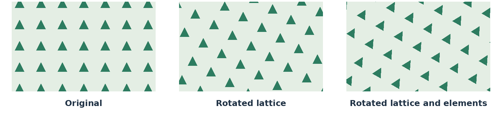
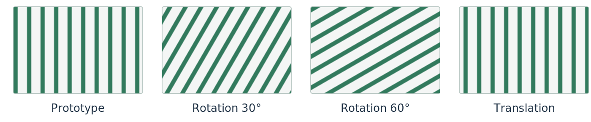
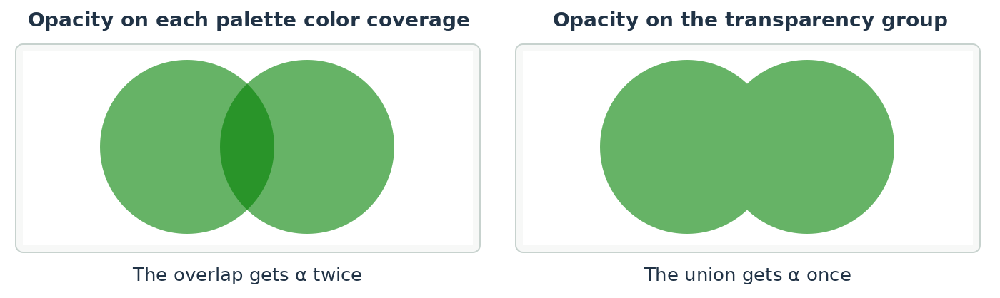
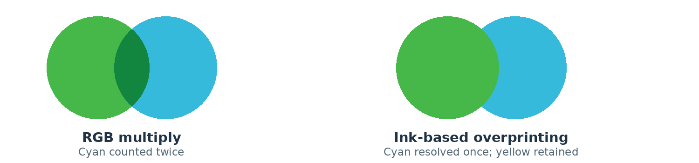
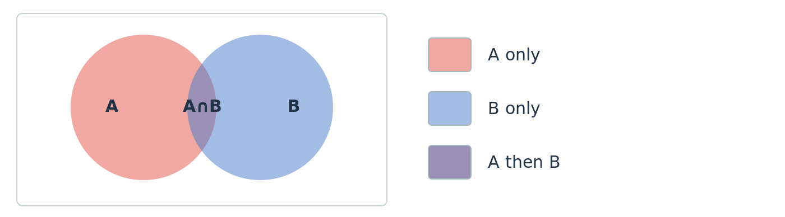

# Palette-layer vector graphics architecture

> This is a working document converted from `Palette_Layer_Vector_Graphics_Specification_Revised.docx` on Nov 17, 2026.
> This text was written again on Nov 21, 2026, in the terms of [Glossary.md](Glossary.md) and by the structure of the passes (@Pauli, Nov 21).
> This specification was never the basis of NotPurplePen. Rather this is the reference for an architecture change of upstream's map model, to be later on integrated into NotPurplePen. Where NotPurplePen already knows how to take the model further, this specification does not bind as such, and the knowledge can be used to develop this specification further.
> By default, the branch feature/multiply-blending is the oracle of this work (@Pauli, Nov 17).
> That branch is an oracle of the appearance only, not a model of the implementation. The goal of this work is the architecture that this specification separates: pass 1 makes the instances, and pass 2 composites them. feature/multiply-blending gets its appearance in another way: it blends an ink as a layer around the drawing of the symbols. Where this specification leaves room to do the same, the room is not meant. The work does not read the code of that branch (@Pauli, Nov 18).
> OCAD and OpenOrienteering Mapper are the authorities on how their own maps render. For Mapper maps, Mapper is an oracle of the appearance: this architecture may organize the vector structure in its own way, but where Mapper implements the function, the result must look as Mapper draws it, except where we find a bug in Mapper (@Pauli, Nov 17).

Design specification / Cartographic rendering

**A generalized vector model of palette separations, with symbol-driven layer instantiation of affine-transformed periodic coverages and compositing in palette order.**

This architecture is intended for application within a surrounding system design. It captures the essential rendering architecture of OCAD and OpenOrienteering Mapper (OOM) in terms that the channels Skia, PDF and SVG can express. It is independent of the color space. The transparency flattening is a separate optimization task.

[Glossary.md](Glossary.md) gives the names of the concepts: the name in the code, which is the primary name, and the Finnish and the English term. [Progress.md](Progress.md) gives the decisions of the work with their dates. The oracles of the appearance, with their sources and measurements, are in [oracles/](oracles/).

## Relationship to OCAD and OOM

Both applications draw by a table of colors in priority order, and not only by the drawing order of complete objects. Each element of a symbol adds geometry to its own color. In its PDF export, OCAD applies a blend mode to each color. OOM simulates the overprinting of the spot colors. Both applications can turn and move the patterns of each object. [1–5]

| Cartographic concept | In this architecture |
|---|---|
| Color table and color priority | The palette colors (`SymColor`) in palette order: the palette stack |
| Symbol elements | The clipping objects of the palette color coverages of the symbols (`SymbolCoverage`) |
| Solid area fills | The full coverage G = 1 |
| Hatched and structured area fills | The periodic coverage G of a hatching or of an area pattern, or the elements that a fill mode selects |
| Pattern offset and orientation | The affine transformation M of a configuration, from the lattice transformation L and the element transformation E |
| Opacity / alpha and blend mode | The opacity α and the blend mode B of the palette color, which pass 2 applies once to its transparency group |
| Overprint (OCAD) / knockout (OOM) | Inverse terms for the printing behavior, apart from α |

## Scope of equivalence

The architecture keeps the palette color apart from the ink. It supports the direct compositing of the colors and the ink separations. RGB and CMYK are representations of a color, and not properties of a coverage. [1, 2, 4]

## 01 / The structure of the passes

The architecture has three parts: the map side, the intermediate layer that pass 1 makes from the map, and the rendering side. Sections 02, 03 and 04 give the three parts. This section gives the whole.

### The units

| Unit | Part | Role |
|---|---|---|
| `Map` | Map side | The source. It keeps the ideal forms. |
| `SymColor`, palette color | Map side | The color C, the opacity α, the blend mode B, the knockout, the ink components and the priority. |
| `CoveragePrototype`, coverage prototype | Map side | The coverage G in its origin-bound form: the full coverage, a hatching or an area pattern of a `SymDef`. |
| `Symbol`, symbol | Map side | One object of a map, with its symbol key (`Symbol.Key`). |
| `SymbolCoverage`, palette color coverage of a symbol | Intermediate layer | The coverage of one `Symbol` in one palette color with one G: the triple (`Symbol`, `SymColor`, G). |
| `PaletteSeparation`, palette separation | Intermediate layer | The palette color coverages of the symbols in one palette color. |
| `PaletteCutter`, palette cutter | Intermediate layer | The palette color coverages of the symbols in one palette separation that have the same configuration. |
| `ClippingObject`, clipping object | Intermediate layer | A derived value that limits the extent over which G applies. |
| Transparency group of a palette color | Rendering side | The group that pass 2 composites for one palette color. |
| Encoding | Rendering side | It writes the drawing for one channel. |

### The coverage and the color

A palette color takes part in the drawing only where its coverage is. A coverage is binary: a point of the plane is in the coverage, or it is not. The coverage of a palette cutter is G under M inside the union of its clipping objects. The clipping objects give no color and no alpha. The color C, the opacity α and the blend mode B belong to the palette color alone.


Figure 1. A clipping object limits the extent of the periodic coverage G. The coverage that results stays binary.

In compositing, the alpha has two parts: the coverage and the opacity. This architecture keeps them apart. G and the clipping objects give the binary coverage, and the opacity α is a property of the palette color.

### The two passes

**Pass 1, layer instantiation.** `Map` makes the palette separations of the palette color coverages of the symbols, and their palette cutters, from the map alone. Pass 1 takes no rectangle and no resolution of a drawing. The symbol definitions give the derived values of the palette color coverages of their symbols.

**Pass 2, layer composition.** Pass 2 takes the palette separations in palette order. For each palette separation, an encoding writes the transparency group of its palette color. C, α and B apply once to the group. Pass 2 does not call the drawing code of the symbols (`Draw`).


Figure 2. Pass 1 makes a palette separation for each palette color, and in it a palette cutter for each configuration: here, the green hatching has three configurations. Pass 2 composites the transparency groups of the palette colors in palette order.

### The rules of the structure

- `Map` is the source. It keeps in its ideal form the information that an encoding needs: the palette colors in palette order, the symbol definitions with their parts, the symbols with their geometry in paper coordinates, and the metric that the source means to be used.
- The intermediate layer is not source data. `Map` makes it from the map, and `Map` stays the source.
- When an encoding needs information, `Map` keeps it, and the intermediate layer gives access to it in forms that are more usable for the needs of the channels. The encoding recognizes no structure.
- `Map` offers the known channel conversions as the means to make derived values from its ideal forms. `Map` keeps a derived value where the shared use of the channels or a cache of the results makes it sensible.
- The palette colors of a map are drawn by pass 2 only. The normal view is a rendering mode of pass 2, as the simulated overprinting and the ink separations are.
- An encoding writes its channel directly. `IGraphicsTarget` stays beside the palette stack, and it draws what does not belong to the palette stack.
- One palette stack is for all the maps, the courses included.
- The coverages and the compositing of the colors are at different levels of the architecture. The number of palette cutters can grow apart from the number of palette colors. The inks are independent of both.

## 02 / The map side

`Map` is the source, and it keeps the structure in its ideal form. This section gives what `Map` keeps: the palette colors and the inks, the symbol definitions and the symbols with their keys, the coverage prototypes and the ideal forms of the lines. It also gives what is beside the palette stack.

### The map and the ideal form

- `Map` holds the palette colors (`SymColor`), the symbol definitions (`SymDef`), the symbols (`Symbol`), the templates (`TemplateInfo`), the scales, the print area, the georeferencing and the metric.
- The geometry of a symbol is in paper coordinates: millimeters on the printed map. The points are `PointF` values. The real-world coordinates (`RealWorldCoords`) are the georeferencing of the map, and not the coordinates of the geometry.
- The ideal form is the form in which `Map` keeps a structure, apart from the form of a channel: the information that an encoding needs. For example, `Map` keeps the curves of the paths as Bezier curves.
- The derived values are not ideal forms. Section 03 gives them.
- The map of the courses, the course map, is a `Map` of its own. `CourseLayout.RenderToMap` makes it from the courses, so the same pass 1 applies to it. Upstream makes the course map again when its `CourseLayout` changes (`MapDisplay.SetCourse`).

### The palette colors and the palette stack

A palette color (`SymColor`) is a color of the normal layer (`SymLayer.Normal`). It has these properties:

| Property | Meaning |
|---|---|
| C, color | A spatially constant color, independent of the color space. Upstream keeps a CMYK color (`CmykColor`). |
| α, opacity (`SymColor.Opacity`) | A spatially constant opacity. |
| B, blend mode (`SymColor.BlendMode`) | The compositing operation (`ColorBlendMode`). |
| Ink components (`SymColor.InkComponents`) | The inks of the palette color, each with its factor. |
| Knockout | The printing intent: keep the inks below, or remove them. |
| Priority | The place of the palette color in the palette order. |

- C, α and B belong to the palette color alone. The coverage prototype G and the affine transformation M give where the palette color takes part, and they do not belong to the palette color. Section 03 gives M.
- The opacity of OCAD corresponds to α.
- For an OCAD map, B = Darken is the larger share of each ink, and not the RGB minimum.
- The palette order is the order of `Map.AllColors`. Upstream draws the colors from the lowest to the highest.
- The palette stack is the transparency groups of the palette colors in palette order. Pass 2 composites them in this order (section 04). One palette stack is for all the maps, the courses included.

### The inks

- An ink (`Ink`) is a colorant identity, apart from the palette color. It has a name (`Name`), a CMYK appearance (`Appearance`), and a screen frequency and angle where they are defined (`Screen`, `InkScreen`).
- The process inks C, M, Y and K always exist (`Ink.ProcessInks`). They are the same for all the maps, and they have no screen.
- A palette color holds ink components (`SymColor.InkComponents`). Each ink component (`InkComponent`) has an ink and a factor from 0 to 1. A missing component and the factor 0 are different.
- A palette color can refer to one ink at a factor, to a mixture of inks, or to a direct color. A palette color that has no spot definition consists of the process inks, with its CMYK values as the factors. A spot ink can be a palette color by itself, at full tint (`SymColor.SpotInk`).
- The CMYK process colors are the case of four inks of this model, and the spot inks extend it. RGB describes a direct color or a simulated appearance. [1, 4]
- The overprint flag of an OCAD process color (`SymColor.OverPrint`) keeps the inks below. The knockout flag of OOM removes them. The two flags give inverse printing intents. The knockout is apart from α and from B. The Mapper import sets `SymColor.OverPrint` only for a color that has a spot definition and whose knockout is off.
- An ink separation is the coverage of one ink. A palette color with a missing share of an ink leaves the ink separation as it is. The share 0 % erases it, and a positive share sets the coverage. [1, 4, 12–13]

### The symbol definitions and the symbols

- A symbol definition (`SymDef`) defines a kind of object of a map: for example a `PointSymDef`, a `LineSymDef`, an `AreaSymDef` or a `TextSymDef`.
- A symbol (`Symbol`) is one object of a map: for example a `PointSymbol`, a `LineSymbol`, an `AreaSymbol` or a `TextSymbol`. A `PointSymbol` and a `RectLikeSymbol` have a location. A `LineLikeSymbol` has a path (`SymPath`). An `AreaLikeSymbol` has a path with holes (`SymPathWithHoles`).
- A glyph (`Glyph`) defines a point symbol definition, or a part of a line or an area symbol definition. Its parts (`Glyph.GlyphPart`) are lines, areas, circles and filled circles.
- The extra transformation of a glyph (`extraTransform`) transforms the points of the glyph, but not its line widths: for example for the scale at the corners and for the glyphs that decrease. So it is not an affine placement of a stroked shape.

### The symbol keys and the course object keys

- The identity of a `Symbol` is its symbol key (`Symbol.Key`). The maker of the `Symbol` gives it.
- In a `Map` that is read from a file or edited, `Map` gives the symbol key from a counter whose values it does not use again. When an edit replaces a `Symbol`, the replacing `Symbol` gets the same symbol key. The undo restores the symbol key, and a self-supporting vector file carries it.
- In the course map, `CourseLayout.RenderToMap` makes the symbol key from `EventDB`: from the course object key (`CourseObj.Key`) of the course object that made the `Symbol`, and from the index of the `Symbol` among the symbols of that course object. So a course map that is made again gives the same symbol keys to the same course object.
- The symbol key is unique in its `Map`, so the reference of a drawn object also gives the `Map`. All the drawn objects of a `Symbol` share its symbol key, so the symbol key is not the `id` of an SVG element. It is not `SymDef.SymbolId`, which is the number of a symbol definition.
- A course object (`CourseObj`) is one object of the courses on the course map: for example a control circle, a leg or a description. `CourseFormatter` and `TopologyFormatter` make the course objects of a `CourseLayout` from the data of `EventDB`, and `CourseObj.AddToMap` makes their symbols in the course map. One course object can make many symbols.
- The course object key (`CourseObj.Key`) is the identity of a course object. `CourseFormatter` or `TopologyFormatter` gives it at the place where it makes the course object. The key has three parts: the role of the place in the data of `EventDB`, the identifiers of `EventDB` that the place uses, and the `CourseLayer`.
- Each place has a role of its own, so two places do not give the same key. The class of the `CourseObj` is not a part of the key: when a whole leg becomes flagged, its key stays the same. The fields `controlId`, `courseControlId`, `courseControlId2` and `specialId` are associations that the selection uses, and not the identity.
- The symbol keys and the course object keys stay the same over the edits and over the course maps that are made again, as the mutations of the SVG DOM in a browser need them.

### The coverage prototypes

- A coverage prototype (`CoveragePrototype`) is the coverage G in its origin-bound form, before M places it. On the map side, G is a part of a `SymDef`: the full coverage (`CoveragePrototype.FullCoverage`), one hatching (an index in `AreaSymDef.hatchings`) or one area pattern (an index in `AreaSymDef.patterns`). In an `AreaComboSymDef`, the component definition is a part of G.
- A periodic coverage G is a binary, spatially repetitive and origin-bound selector: for each point of the plane, G tells if the point is in the coverage. In mathematics, G is the indicator function of a set of the plane that the translations of a lattice do not change. The hatchings and the area patterns are periodic coverages.
- For a point p of the drawing, the selector is G(M⁻¹p), where M is the affine transformation of a configuration (section 03). The prototype is origin-bound, and M is relative to the coordinates of the map. M keeps G binary and periodic.
- The full coverage is the whole plane: G(x, y) = 1 at each point. A constant function does not change in a translation, so it is periodic with each lattice. The full coverage is the trivial case of a periodic coverage, and not a kind of its own. No M changes it.
- The G of the points, the lines, the texts and the area fills is the full coverage. An opaque palette color with the full coverage is an ordinary case of the architecture, and not a special component.
- The dash patterns and the glyphs along a line are strokes and placements, and not lattices. The shared shapes of a glyph are not coverage prototypes. A glyph belongs to G only as the element of an area pattern (`PatternInfo.patternGlyph`).
- The pattern fills are coverages, and not paint functions or other properties of the rendering.
- Two periodic coverages that their M transform independently need not share a repeating unit.

### The hatchings and the area patterns

- The area fill (`AreaSymDef.FillColor`) is the solid fill of an area in one color. Its G is the full coverage.
- The area border (`AreaSymDef.BorderSymdef`) is the line symbol definition with which an area is bordered. `AreaSymDef.Draw` draws it along the main path and along each hole.
- The pattern fills are the hatchings (`HatchInfo`) and the area patterns (`PatternInfo`).
- A hatching (`HatchInfo`) has a color, a width, a spacing, an offset, an angle and a rotate mode. A hatching is a coverage prototype of its own: stripes, whose symmetries include all the translations along the lines. A cross hatching is two hatchings, so it has two coverage prototypes.
- An area pattern (`PatternInfo`) has an element (`patternGlyph`), the size of the element (`patternWidth`, `patternHeight`), an offset of the alternate rows by 1/2 (`offsetRows`), an angle, an offset, a rotate mode, a fill mode and the irregularity.
- The fill mode (`AreaSymDef.PatternFillMode`) clips the elements (`Clip`), or selects the complete elements that are entirely inside (`CompletelyInside`), centered inside (`CenterInside`) or partially inside (`PartiallyInside`) the area. [3, 5]


Figure 3. The fill modes: clip the elements, or select the complete elements that are entirely inside, centered inside or partially inside the area.

- The lattice is the arrangement in which an area pattern repeats its element. The size of the element and the offset of the rows give the lattice. The center of an element is its origin, the point that the lattice places at a lattice vector.
- The lattice and the element can turn independently. The point e of the element at the lattice vector v is at L(v) + E(e), where L is the affine lattice transformation and E is the affine element transformation. E applies in the frame of the drawing, to each element about its own lattice point. [3]
- In OCAD, the structure angle of the symbol (`PatternInfo.patternAngle`, `HatchInfo.hatchAngle`) turns the lattice alone. The angle of an area object (`AreaSymbol.Angle`) turns the lattice and its elements together. [3]



Figure 4. The lattice can turn apart from its elements, and both can also turn together.

- The rotation center (`AreaSymbol.RotationCenter`) is the point about which the angle of an area object turns its hatchings and its area patterns. It is also their origin: the transformation of a hatching is T(rotation center) · R(angle of the area object) · R(structure angle). The OCAD import sets the rotation center to the origin of the map. The Mapper import takes it from the pattern origin of the object (`rotationCoord`).
- The rotate mode (`AreaSymDef.RotateMode`) is `Always`, `ManualOnly` or `Never`. In this specification, `ManualOnly` is the same as `Always`: M takes the angle and the rotation center of the `AreaSymbol`. Only `Never` leaves them out, as the drawing of upstream does. The difference is in the editing: when the object or the map turns, `Always` turns the angle with it, and `ManualOnly` keeps the angle.
- The elements of an irregular pattern (`PatternInfo.irregular`, with `irregularVarX`, `irregularVarY` and `irregularMinDist`) move a random but deterministic distance. The seed comes from the rounded position of the element. `Map` keeps the randomness as a definition.

### The lines

- A line symbol definition (`LineSymDef`) has the dashes (`DashInfo`), the double line (`DoubleLineInfo`), the shortening and the pointy ends (`ShortenInfo`), and the glyphs along the line (`GlyphInfo`). A `LineComboSymDef` gathers other line symbol definitions, its component definitions.
- The base path is the `SymPath` along which a `LineSymDef` is drawn. For a line object, it is `LineLikeSymbol.Path`. For the border of an area, it is the main path or a hole of the `AreaLikeSymbol`.
- The ideal form of a line is the base path with the flags of its points, the `LineSymDef` with its `DashInfo`, `DoubleLineInfo`, `ShortenInfo` and `GlyphInfo`, and the metric. `Map` keeps it. Section 03 gives the derived values of a line.
- The corner points and the dash points of a path (`PointKind.Corner`, `PointKind.Dash`) divide a line into segments. The start and stop flags of the points delimit the subpaths of a path (`SymPath.GetSubpaths`), for example for a border of a double line.
- A double line (`DoubleLineInfo`) has a fill and two borders, the left and the right border. `doubleThick` is the distance between the borders and the thickness of the fill.
- The measure of the line is the metric that the source means to be used. `Map` keeps it in its ideal form (`Map.UseEuclideanMetric`). The metric of a map is `Map.MapDistanceMetric`.
- The OCAD metric is the larger coordinate difference plus half the smaller one (`SymPath.BizzarroDistance`): a norm whose unit circle is an octagon. A map uses the OCAD metric when its view parameter `p` is 1. The Mapper maps use the euclidean metric. The OCAD metric is best effort.
- The shortening of a line is measured with the metric of the map. The text along a line is measured with the OCAD metric in all the maps, as current OCAD does.
- [OcadLines.md](../OcadLines.md) gives how OCAD draws the lines: the metric, the dashes, the double lines, the glyphs along a line and the text along a line.

### Beside the palette stack

- The templates (`TemplateInfo`) are not palette colors. Upstream draws them under and over the palette colors (`Map.Draw`). An OCAD template is a `Map` of its own.
- The layers of `SymLayer` are layers in the sense of image editing. The image layer (`SymLayer.Image`) is below all the normal layers, and the layout layer (`SymLayer.Layout`) is above them. Their objects have a special symbol definition (`ImageSymDef`), and they are not palette colors.
- The normal layer (`SymLayer.Normal`) is between the image layer and the layout layer. It holds the transparency groups of the palette colors in palette order, as a group of layers holds layers in image editing.
- Upstream draws the image layer and the layout layer with the same loop as the colors (`DrawColor`), through two pseudo-colors without a color value (`Map.ImageColor`, `Map.LayoutColor`). They are not palette colors.
- The templates, the image layer and the layout layer have no palette color coverages. They are drawn beside the palette stack (section 04).

## 03 / The intermediate layer

`Map` makes the intermediate layer from the map alone, in pass 1. The intermediate layer is not source data, and `Map` stays the source. This section gives the units of the intermediate layer, their configurations, and the derived values with their forms.

### Pass 1

- Pass 1, layer instantiation, makes the palette separations and their palette cutters from the map alone. It takes no rectangle and no resolution of a drawing. To keep to the rectangle of a drawing is the work of pass 2.
- Pass 1 takes the visible symbol definitions that have a palette color, and their visible symbols, wherever the symbols lie.
- The templates, the image layer and the layout layer are not in the intermediate layer.
- The symbol definitions give the derived values of the palette color coverages of their symbols.

### The palette color coverages, the palette separations and the palette cutters

- A palette color coverage of a symbol (`SymbolCoverage`) is the coverage of one `Symbol` in one palette color with one coverage prototype G: the triple (`Symbol`, `SymColor`, G). Its coverage is G under M inside the union of its clipping objects.
- A symbol has one palette color coverage for each G in a palette color. Usually it has one. A cross hatching gives two, as upstream imports it as two hatchings of one color (`OcadImport`).
- A palette color coverage of a symbol refers to its `Symbol`, its `SymColor` and its G, and it copies nothing. It keeps its own derived values.
- A palette color coverage of a symbol is a coverage, and not a separation. A separation is named by what it separates by, as the ink separation and the palette separation are.
- A palette separation (`PaletteSeparation`) is the palette color coverages of the symbols in one palette color. It keeps its palette cutters as a derived value.
- A palette cutter (`PaletteCutter`) is the palette color coverages of the symbols in one palette separation that have the same configuration. It cuts the uniform color of the palette color to the coverage that G under M gives inside the union of its clipping objects.
- Each palette color coverage of a symbol is in one palette cutter, and each palette cutter is in one palette separation.

### The configurations

- The configuration of a palette color coverage of a symbol is its palette color, its G and its effective affine transformation M. M comes from the `Symbol` and from G.
- M is an invertible 2D affine transformation of G, and its default is the identity. M can translate, rotate, scale, shear or reflect G. The translation and the rotation are necessary now, and the architecture admits all the invertible 2D affine transformations.
- For a hatching or an area pattern, M comes from the angle and the rotation center of the `AreaSymbol` (`Angle`, `RotationCenter`) and from the angle and the offset of G. The rotate mode `Never` leaves out the part of the `AreaSymbol`.
- Two configurations are the same when they give the same coverage: the palette color and the coverage prototype are the same, and M₁⁻¹M₂ is a symmetry of G. A symmetry of G is an affine map S for which G∘S = G.
- The symmetries of an area pattern include the translations of its lattice. The symmetries of a hatching include all the translations along its lines, and the translations across them by multiples of the spacing. All the maps are symmetries of the full coverage. So the palette color coverages with the full coverage in one palette separation are one palette cutter.
- A normal form decides the sameness. The translation of M is reduced into a fundamental domain of the translations that are symmetries of G, and it is rounded to a fixed precision. The configurations with the same normal form are the same, and the relation is an equivalence.
- The effective transformations can vary by symbol, by object and by element. Pass 1 makes a palette cutter for each configuration that no palette cutter has yet, and not only one for each symbol. The configurations that are the same share one palette cutter. The composition by palette color does not change.



Figure 5. One coverage prototype in four configurations: the prototype, two rotations and a translation. The palette cutters of the configurations refer to the same prototype, and the M of each gives its phase and its direction.

### The clipping objects and the union

- A clipping object (`ClippingObject`) limits the extent over which G of its palette cutter applies. It gives no color and no alpha. The clipping objects of a palette color coverage of a symbol are its derived values.
- The union of the clipping objects of a palette cutter is a true union, also where each area fills with the even-odd rule.
- The coverage of a palette separation is the union of the coverages of its palette cutters. The union can stay implicit in the rendering, but the palette color coverages of the symbols cannot be left out.
- The clipping objects of a clipped pattern fill are the areas of the palette color coverages of the symbols in a palette cutter. So the overlapping areas of one configuration get the pattern once, in their union.

### The selected elements

- OCAD and OOM keep the clipped pattern fills apart from the fill modes that select complete elements by their relation to the area. Pass 1 resolves this difference, and not the composition by palette color. [3, 5]
- A clipped pattern fill keeps its periodic coverage G.
- The elements that a fill mode selects, and the placements of the elements of an irregular pattern, are derived values of a palette color coverage of a symbol. The composite representations of the selected elements are left to a later refinement.
- Upstream selects each part of a glyph by its own points and center (`GlyphPartFilter`), and not the complete element.

### The derived values

- A derived value is a result that `Map` gives from the ideal form for the needs of the channels. It is not an ideal form, but a practical adaptation of the ideal form. Its form depends on what the implementations that the channels choose need: for example, the dashes on a curve can be Bezier pieces, polylines or both.
- `Map` offers the known channel conversions as the means to make the derived values. `Map` offers all the geometric conversions, and their results are forms of `Map`: shapes, strokes, placements and polylines. For example, the conversion of the arcs into Bezier pieces is a channel conversion of `Map`.
- `Map` keeps a derived value where the shared use of the channels or a cache of the results makes it sensible. A derived value is calculated when it is necessary the first time, and it becomes invalid when the map changes. A derived value that `Map` keeps acts as a computed value of reactive programming. Upstream keeps derived values in the same way, for example `SymPath.flatpoints`, `TextSymbol.wrappedText` and `Symbol.boundingBox`.
- A palette color coverage of a symbol keeps its own derived values: for example the clipping objects, the parts of a line, the fitted dash patterns, the runs of dashes in the euclidean measure, the offset curves, the placements and the elements that a fill mode selects.
- A derived value that depends on a definition alone belongs to the definition: for example the shared shapes of a glyph and a pattern tile.
- A palette separation keeps its palette cutters as a derived value.
- The channel conversions of the lines are, for example, the runs and the single dashes in the euclidean measure, a dash table, the repeated placements with a euclidean step, the pieces of the base path, the offset curves, and the expansion into single dashes and single placements. The channel conversions of the pattern fills are, for example, the placements of the elements of an irregular pattern, and a pattern tile that the conversion composes from single elements.

### The forms of the derived values

- A clipping object has a shape that is drawn (`ClippingObject.Shape`), a fill or a stroke, and a placement (`Placement`). For a filled shape, the shape is the outline of the area. For a stroked shape, the shape is the path at the middle of its stroke shape.
- A shape (`Shape`) is a path (`PathShape`), an ellipse (`EllipseShape`), an arc (`ArcShape`) or a text run (`TextShape`). The shapes keep the ellipses and the arcs as ellipses and arcs, as the channels make polylines of them each in its own way. The border of a double line is an offset path.
- In the painting models of PostScript, PDF and SVG, a path is painted with a fill or with a stroke. A fill paints the inside of the path by a fill rule (the operator `f` of PDF). A stroke paints the band that a pen draws along the path (the operator `S`).
- A filled shape (`FilledShape`) is the one kind: it paints the inside of its shape by its fill rule (`FilledShape.FillRule`). A stroked shape (`StrokedShape`) is the other kind: a shape that a pen draws along its path.
- The stroke shape is the band that the pen of a stroked shape covers along its path: its coverage. SVG 2 calls it the stroke shape. With round caps and joins, it is the Minkowski sum of the path and a disk as wide as the pen, that is the area that the disk sweeps.
- A stroke (`Stroke`) has the width (`Width`), the caps (`Caps`), the join (`Join`), the miter limit (`MiterLimit`), and the dash pattern and its phase (`DashPattern`, `DashPhase`). A stroke has no color, as the palette color gives the color. The symbol definitions give the caps and the joins together as a line style (`LineStyle`).
- The dash pattern and the dash phase of a stroke are in the measure of the channels: euclidean, along the own path of the stroked shape, as `stroke-dasharray` and `stroke-dashoffset` of SVG, the dash pattern of PDF and the dash effect of Skia measure. They belong to the runs of dashes. The dash structure in the measure of the line is the fitted pattern of a part of a line, and not a part of `Stroke`.
- A text run (`TextShape`) is a word, or a grapheme where the character spacing is more than 0, at its own position. It has the text, the font family, the size, the effects and the top left corner. The channels take the positioned runs as they are, and the positions stay as Purple Pen measures them.
- The framing of a text run in the style `FramingStyle.Line` is one line: a stroke of the full width with the joins of the symbol, as the PDF export of OCAD draws it.
- The shared shapes of a glyph are one shape for each part of the glyph, and each placement of the glyph refers to them. Stretched and diminishing glyphs get shapes of their own.
- A pattern tile is one cell of an area pattern, which a channel conversion composes from single elements.

### The placements

- A placement (`Placement`) gives one or more poses. Each reader asks a placement for its poses.
- A pose is a point and an angle (x, y, θ). In the plane, it is a rotation and a translation, that is a rigid motion.
- A placement keeps its sequence of steps (`Placement.Steps`): the affine transformations in the order in which the symbols set them. The pose is the innermost step. The placement composes its steps into one matrix (`Matrix`). Skia composes nested transformations with its own rounding, so with the same steps in the same order, the coverage is the same to the pixel.
- A single placement keeps one pose.
- A repeated placement keeps its path, its first position along the path, its step and its count. It calculates its poses from the path: the point of the path at each position along the path, and the direction of the path there, with the method of the drawing. Only an encoding that gives a repeated placement to an abstraction of its channel reads the path and the step.
- A position along the path is a distance from the start of a path, in the measure of the line: the arc-length parameter s of the path. The step is the distance between two adjacent positions of a repeated placement, and the count is the number of its poses.
- The evenly spaced glyphs of each part of a line are one repeated placement of the shared shapes, on straight and curved parts alike. On a Bezier curve, the glyphs of the OCAD spacing repeat by quarters, so the quarters have different steps.
- The glyphs at the corners, at the dash points, at the start and at the end of a line are single placements of the shared shapes.

### The structure of a line

- `Map` keeps the ideal form of a line (section 02). The structure of a line also has what PDF and SVG cannot describe: the parts as pieces and offsets of the base path, the measure of the line, the fitted pattern of a part, the end dashes and the exceptions of fix 020. These are derived values, and they are the same for all the channels.
- A line component is one of the components that a `LineSymDef` draws from the base path: the main line, the secondary line, the double line fill, a double line border, the pointy ends or the glyphs along the line.
- A piece is an interval of the base path: its start and its end, as positions along the path in the measure of the line. The start and stop flags of the points and the shortening give the pieces of a line component.
- An offset is the distance of a line component from the base path, to the side.
- A part of a line is one line component on one piece of the base path, with its offset: the triple (line component, piece, offset).
- A segment is the section of a piece of the base path between corner and dash points. The fitting gives a dash pattern to each segment, but it calculates the segments of a part of a line together: the minimum gaps apply to the longest segment only, and the decreasing glyphs to the first and the last segment. A segment is not a part of a line.
- The fitted dash pattern (`ComputeDashDistances`) is the dash and the gap that the fitting gives to each segment of a part of a line.
- The end dashes of adjacent segments merge into one dash at a corner point or a dash point.
- An exception of fix 020 is a dash from which the rule of fix 020 leaves out the vertex.
- The offset path is the shape of a border of a double line in its ideal form: the base path and the offset. Its dash pattern is measured along the base path, so the dashes and the runs of a border are the dashes and the runs of the base path moved aside, as in OCAD. The rule of the corners of the offset belongs to the shape, and the join belongs to the stroke. The offset curve is a derived value.
- With the OCAD spacing (`SpacingMethod.OCAD`), each quarter of a Bezier curve has its chord in the metric of the map as its length in the measure. Within the quarter, the dashes and the glyphs are in proportion to the euclidean length of the arc.
- The flattened path (`SymPath.GetFlattenedPoints`) is the polyline that approximates the curves of a path. A vertex is a point of the flattened path, and an edge is the straight piece between two adjacent vertices. The ideal form keeps the curves. A derived value can keep a polyline, and an encoding can choose one.
- A run of dashes is the middle dashes of a segment as one periodic dashed line. The runs in the euclidean measure are the same for Skia, PDF and SVG, as their dash patterns measure the path euclidean.
- With the OCAD spacing, the runs on a Bezier curve are by quarter, and the pattern of a run is scaled by the arc and the chord of its quarter. With the OCAD metric, the runs are also by straight edge: the OCAD metric measures a straight edge as a constant times its euclidean length, so the pattern of the run is scaled to euclidean by the direction of the edge. The dashes over a vertex are then single.
- The composed dashed line is the form of a line for a channel whose dash pattern measures the euclidean length: the runs and the single dashes. An encoding writes it (section 04).

## 04 / The rendering side

The rendering side reads the intermediate layer. It keeps none of the results of the channel conversions that the encodings make themselves. This section gives pass 2, the rendering modes, the encodings and the channels, what is drawn beside the palette stack, the SVG channel, and the drawn objects and the files.

### Pass 2 and the transparency groups

- Pass 2, layer composition, takes the palette separations in palette order. For each palette separation, an encoding writes the transparency group of its palette color. Each palette color has one transparency group.
- The content of the transparency group of a palette color is the color C on the coverage of its palette separation. The group is composited once onto the backdrop, with the opacity α and the blend mode B of the palette color. So the overlaps of one palette color do not get α twice.
- The palette color coverages of the symbols in one palette color give its binary coverage together, by union. In the direct compositing of the colors, C, α and B apply once to that coverage, and not to each palette color coverage separately. The operations by ink are a separate concern of the rendering modes.
- In the group, the encoding writes each palette cutter with one fill and one clip, or each palette color coverage of a symbol separately.
- Pass 2 does not call the drawing code of the symbols (`Draw`). The palette colors of a map are drawn from the intermediate layer only.
- The union can stay implicit in the rendering, but the palette color coverages cannot be left out. To draw the shapes of a palette color into one layer while the symbols are drawn, and to apply α and B to that layer, gives the same appearance, but not this architecture.
- Pass 2 keeps to the rectangle of a drawing, as pass 1 makes the intermediate layer of the whole map.
- The complete palette stack can be isolated, for example with `isolation: isolate` in SVG, to constrain its blending to the drawing. The antialiasing of the boundaries is a concern of the rendering, and not a property of the binary coverage.



Figure 6. The overlap of two palette color coverages of one palette color must not get the opacity α of the palette color twice. The full coverage isolates the principle of the compositing.

- In the transparency model of PDF (ISO 32000), this unit is a transparency group. The objects of the group are composited into one result, and the result is composited onto the backdrop with the opacity and the blend mode of the group. The model of W3C (Compositing and Blending) calls it a group, and image editing and `saveLayer` of Skia call it a layer. [10]
- A group is composited in a blending color space, which can be RGB, or CMYK with spot inks. The separable blend modes, for example Darken and Multiply, apply to each color component. So the group is the same in all the rendering modes, and only the blending space changes. In a CMYK group, Darken takes the larger share of each ink, as the PDF export of OCAD does.
- OCAD applies B only in its PDF export, and not in its own view. Mapper applies α to each shape, so Mapper is not the oracle of α where the shapes of one color overlap.

### The rendering modes

- A rendering mode is a color configuration of pass 2: the normal view, the overprinting that the inks simulate, or the ink separations. All the rendering modes use the same intermediate layer, and a rendering mode does not change it.
- The intermediate layer is independent of the color configuration. The same coverages serve the normal views of the editing, the simulated overprinting, the physical ink separations and the output of the transparency flattening. This is a capability of the architecture, and not a prescription of the implementations of the rendering modes. OCAD distinguishes the normal view and the behavior of the colors in print, and OOM simulates the overprinting. [2, 4, 11]
- Upstream gives the rendering with the render options (`RenderOptions`). For example, `blendOverprintedColors` blends the colors that have the overprint flag with Darken, and `colorBeginDrawExclusive` and `colorEndDrawInclusive` draw only some of the colors.
- The reuse of the coverage prototypes avoids copies of the geometry. The composition by palette color prevents the repeated application of a palette color. Neither of them resolves the inks that different palette colors share. For example, the cyan in a green mixture of inks and the cyan in a blue palette color are resolved in the same ink separation before they mix with the other inks.



Figure 7. An illustrative comparison: a green of cyan and yellow overlaps a blue of cyan. The example with the inks assumes that the overprinting keeps the yellow. The colors are not color-managed simulations.

- For the Mapper maps, the overprinting simulation of Mapper is the oracle of the simulated overprinting. It draws a separation for each ink in priority order: the mixtures draw with their factors, the knockout erases, and a later palette color replaces an earlier one. Then it tints each separation with the CMYK appearance of its ink, and it multiplies the separation into the image.

### The color representation

- The color model is independent of the color space. The architecture supports RGB, CMYK and compositions of spot inks without a change of the coverages.
- An encoding keeps the explicit CMYK components where its channel can keep them, with an RGB representation for the display. OOM distinguishes the RGB of the desktop, the process CMYK and the settings of the spot inks. [4]

### The encodings and the channels

- An encoding writes the drawing for one channel. A channel is an output for which an encoding writes. The rendering channels of the work are Skia, PDF and SVG. The printing draws the pages with Skia on Windows, and as PDF on Linux and macOS.
- An encoding writes its channel directly, and not through `IGraphicsTarget`. The SVG encoding writes SVG, the PDF encoding writes the objects of PdfSharp, and the Skia encoding writes an `SKCanvas`. The vocabulary of a channel belongs to its encoding. A shared drawing interface would level it to the subset that all the channels share.
- An encoding chooses the channel conversions of `Map` that its channel can use, and it writes their results in the vocabulary of its channel. Its own conversions are only the conversions into that vocabulary, for example into SVG elements and attributes, PDF operators and resources, or Skia objects, and the adaptations to the deviations of its channel that no general conversion covers. An encoding does not keep the results of its own conversions.
- When an encoding needs information, `Map` keeps it, and the encoding recognizes no structure. Where the implementation of a channel does not agree with the ideal form, the encoding chooses a channel conversion of `Map`, for example a polyline.
- A channel offers abstractions: for example the dash pattern of PDF and SVG, the 1D path effect of Skia and the markers of SVG.
- A base case is a case that a channel solves with an abstraction of its own. In a base case, the encoding converts the structure directly into a structure of the channel. In the other cases, it splits the structure. The splitting ends in single dashes and single placements, which each channel draws directly. This splitting is the expansion.
- A structure of the derived values is of benefit when it lets the channels solve the base cases with an abstraction that they offer.
- The legalization of a compiler is the model of this division. An operation that the target supports directly is legal, and the other operations are expanded (LLVM: Legal, Expand, Custom). The channel conversions of `Map` are the general expansions, the choice of an encoding is the table of what is legal, and the own conversions of an encoding are the custom lowering and the emission.
- An encoding writes a line as a composed dashed line for a channel whose dash pattern measures the euclidean length. A straight edge with the OCAD metric is a base case, which the dash pattern of the channels solves.
- An encoding gives the repeated placement of the glyphs along a line to an abstraction of its channel: the 1D path effect of Skia for any glyph, the dash pattern of SVG and PDF for dots and for ticks that are symmetric across the line, and the markers of SVG. Where no abstraction fits, the encoding expands the repeated placement into single placements.

### Beside the palette stack

- `IGraphicsTarget` is the interface on which the symbols draw now. Its implementations are classes such as `Skia_GraphicsTarget` and `Pdf_GraphicsTarget`. Its vocabulary is a subset of the imaging model of PostScript, with flags for the differences of the channels (`SupportsPatternBrushes`).
- The graphics targets that matter to the work are Skia, PDF, the printing and the coming SVG implementation. GDI+ and WPF are legacy, and Direct2D and iOS are not in use. Of the graphics targets, the application that ships refers to Skia (`Map_SkiaStd`) and PDF (`Map_PDF`) only.
- `IGraphicsTarget` stays beside the palette stack. It draws what does not belong to the palette stack: the templates, the highlights and the control descriptions (`DescriptionRenderer`), and the old drawing code until that code goes away.
- The templates, the image layer and the layout layer are drawn beside the palette stack, below it or above it as their places in the map are (section 02).
- The encoding and the graphics target of one channel share the surface of the channel, for example the same `SKCanvas` or the same PDF page.
- The highlights (`Symbol.DrawHighlight`, `CourseObj.DrawHighlight`) are drawn directly on the graphics target. They stay a direct drawing beside the palette stack in the channels that have a graphics target. A direct drawing keeps nothing over the renderings: the selection keeps the state, and each rendering draws the highlights again.

### The SVG channel

The structure can be expressed with the primitives of SVG. These primitives are mechanisms of the SVG encoding for the same structure, and not distinctions in the architecture.

| Structure | SVG representation |
|---|---|
| The uniform color of a palette color | Filled rectangles |
| The union of the clipping objects of a palette cutter | A clipping path |
| A periodic coverage G | An origin-bound pattern fill in one color, with unpainted gaps |
| The affine transformation M | `patternTransform` |
| The opacity α of the transparency group | `opacity` |
| The blend mode B of the transparency group | A blend mode (`mix-blend-mode`) |

A pattern reference of SVG can inherit a reusable definition and override selected attributes. So the pattern of a palette cutter with a transformed coverage prototype needs only a reference and its transformation, and not a copy of the prototype. Figure 5 shows such configurations. [6–7]

```xml
<defs>
  <!-- Coverage prototype: one definition of G -->
  <pattern id="hatch" patternUnits="userSpaceOnUse"
           width="8" height="8">
    <rect width="2" height="8" fill="#008000"/>
  </pattern>

  <!-- Configurations refer to the coverage prototype -->
  <pattern id="hatch-30" href="#hatch"
           patternTransform="rotate(30)"/>
  <pattern id="hatch-60" href="#hatch"
           patternTransform="rotate(60)"/>
  <pattern id="hatch-offset" href="#hatch"
           patternTransform="translate(2 4)"/>
</defs>
```

A pattern is a paint server in SVG, but it represents a binary periodic coverage. The gaps of a pattern are unpainted. A pattern fill inside a `clipPath` does not define a repeated clipping coverage, so the encoding clips the painted element instead. [8]

For the direct compositing in RGB, the SVG groups the palette cutters of a palette color, which are painted with the opaque color of the palette color, and applies the opacity and the blend mode to the group. Each rectangle of the example is one palette cutter, with one fill and one clip. The example assumes that the clipping paths are defined. [9–10]

```xml
<g id="palette-green" opacity="0.6"
   style="mix-blend-mode:multiply">
  <rect width="100%" height="100%"
        fill="url(#hatch)"
        clip-path="url(#cutter-1)"/>
  <rect width="100%" height="100%"
        fill="url(#hatch-30)"
        clip-path="url(#cutter-2)"/>
  <rect width="100%" height="100%"
        fill="url(#hatch-60)"
        clip-path="url(#cutter-3)"/>
</g>
```

SVG 1.1 supports color definitions that are based on ICC, beside a fallback in sRGB. Inkscape documents this representation. Scribus documents that it imports the ICC colors of four components as CMYK, without the application of the referenced profile. The compatibility depends on the renderer and on its version. [14–16]

```xml
<defs>
  <color-profile name="print-cmyk"
                 xlink:href="print-profile.icc"/>
</defs>
<rect width="100%" height="100%"
      fill="#009933 icc-color(print-cmyk, 1, 0, 1, 0)"
      clip-path="url(#green-cutter)"/>
```

This fragment is illustrative. The surrounding SVG must declare the namespace of xlink, and it must supply the actual ICC profile and the clipping path. The RGB fallback is illustrative, and not a conversion by the profile. Some browsers reject the ICC paint declarations, and they do not show the fallback. A CMYK serialization alone does not implement the overprinting by ink.

The SVG fragments of this specification are illustrative. Their behavior in Inkscape, in Scribus and in the rendering engines of the browsers is not tested.

### The drawn objects and the files

- A drawn object is an object that an encoding writes. Each drawn object refers to its palette color coverage of a symbol, and through it to its `Symbol`, its `SymColor` and its G. The reference gives the `Map` and the symbol key (`Symbol.Key`).
- The drawn objects do not copy what the structure of `Map` lets them refer to. They use it through references.
- A drawn object links directly to the parts of the content of `Map`. It can take the geometry that it draws by reference from the shared parts of the intermediate layer. The link and the reuse are different references, and they do not limit each other.
- In SVG, `<use href>` and `fill="url(#…)"` reuse, and the hierarchy of the groups or an identifier of the drawn object links. In PDF, a form XObject reuses, and marked content links.
- A self-supporting vector file is an SVG or a PDF file that carries the content of `Map`, so that Purple Pen can one day read it from the file. Purple Pen then reads the content of `Map` from the file, and it does not recognize the content from the geometry of the drawing.
- In a file, the drawn objects keep a link back to the ideal forms that is as direct as possible, also through the hierarchy of the file, so that the SVG graphics can be a part of a web user interface.
- The opening of a file is not in the scope of the epic. The epic includes `Map` with the parts to which an encoding can refer, and these parts make it possible to open a file as a map.

---

# The text of Nov 17

This is the text of Nov 17, with @Pauli's notes of Nov 18 to 20. The sections above replace it part by part, and the last part of the work removes it. Until then, the section and figure numbers that the other documents give refer to this text.

Design specification / Cartographic rendering

**A generalized vector color-separation model with symbol-driven instantiation of affine-transformed periodic geometry and palette-ordered compositing.**

The model is intended for application within a surrounding system design. It captures the essential rendering architecture of OCAD and OpenOrienteering Mapper (OOM) in SVG-compatible terms, with color-space independence and a separate optimization task for vector transparency flattening.

## Relationship to OCAD and OOM

Both applications organize rendering by a prioritized color table, rather than simply by the drawing order of complete objects. Symbol elements contribute geometry to their respective colors. OCAD supports color-specific blend modes for PDF export; OOM supports spot-color overprinting simulation. Both have object-specific pattern orientation facilities. [1–5]

| Cartographic concept              | Corresponding model                                            |
|-----------------------------------|----------------------------------------------------------------|
| Color table and color priority    | Ordered palette entries / compositing layers                   |
| Symbol elements                   | Graphical clipping objects                                     |
| Solid area fills                  | Constant repetitive geometry G = 1                             |
| Hatched and structured area fills | Periodic geometry G, or instantiated clipping objects          |
| Pattern offset and orientation    | Per-instance affine transformations of lattice and element     |
| Opacity / alpha and blend mode    | Independent palette-entry compositing properties               |
| Overprint (OCAD) / knockout (OOM) | Inverse terminology for printing behavior; separate from alpha |

## Scope of equivalence

The architecture distinguishes palette identity from ink identity. It supports direct color compositing and ink-based color separations. RGB and CMYK are color representations, not geometry properties. [1, 2, 4]

References: [\[1\] OCAD: Colors](https://www.ocad.com/wiki/ocad/en/index.php?title=Colors) • [\[2\] OCAD: Blend Mode](https://www.ocad.com/wiki/ocad/en/index.php?title=Blend_Mode) • [\[3\] OCAD: Area Symbols](https://www.ocad.com/wiki/ocad/en/index.php?title=Create_a_New_Area_Symbol) • [\[4\] OOM: Color Window](https://www.openorienteering.org/mapper-manual/pages/color_dock_widget.html) • [\[5\] OOM: Pattern Rotation](https://github.com/OpenOrienteering/mapper/wiki/Notes-on-.ocd-format-and-Mapper-compatibility)

## 01 / Logical model: Palette layers and geometry

The drawing comprises an ordered stack of palette layers. In the initial single-instance model a layer is described by the following properties. Ink and knockout semantics extend the palette definition independently of geometry (section 06).

| Property           | Meaning                                                         |
|--------------------|-----------------------------------------------------------------|
| C — Color          | Spatially constant color, independent of color space.           |
| α — Alpha          | Spatially constant opacity.                                     |
| B — Blend mode     | Compositing operation.                                          |
| G — Geometry       | Binary, spatially repetitive, origin-bound geometry selector.   |
| M — Transformation | Invertible 2D affine transformation of G; defaults to identity. |

G determines whether the layer participates at a given position. Color and alpha belong exclusively to the palette layer. Patterns are instances of repetitive geometry, not independent paint functions or additional rendering properties.

Full coverage is G(x, y) = 1, the constant case of repetitive geometry. An opaque default layer with full coverage is an ordinary instance of the architecture, not a special architectural component.

### Geometry transformations

Each instance can independently translate, rotate, scale, shear or reflect its geometry. Translation and rotation are currently required; the model admits all invertible 2D affine transformations. Lattice and element transformations are distinguished in section 03.

For a point p in the drawing coordinate system, the effective periodic selector is G(M⁻¹p). The prototype is origin-bound; its affine transformation is relative to the global coordinate system. The binary and repetitive character of G is preserved, and constant G = 1 is invariant.

Independently transformed repetitive geometries need not share a common repeating unit.

### Clipping objects

Graphical clipping objects determine the spatial extent over which the respective periodic geometry applies. They do not supply separate color or alpha. Multiple clipping objects associated with the same instance contribute their combined coverage by union.


Figure 1. A clipping object limits the extent of repetitive geometry. The effective coverage remains binary.

## 02 / Extended architecture: Symbol-driven layer instantiation

Object-specific pattern offsets and rotations require implicit instantiation of patterned layers, not duplication of the original geometry prototypes. The final layer setup is determined by symbols and individual map objects, including independently rotated patterned elements.


Figure 2. Symbol processing derives instances from prototypes; composition follows the palette order.

### Two-pass architecture

**Pass 1 — Layer instantiation.** Process symbols and individual map objects. Instantiate each required combination of palette entry, geometry prototype and effective lattice/element transformations; associate its clipping objects. Equivalent configurations may share an instance.

**Pass 2 — Layer composition.** Group instances by palette entry and composite the color separations in palette-priority order under the selected color configuration.

| Entity             | Properties / role                                                   |
|--------------------|---------------------------------------------------------------------|
| Palette entry      | Color, alpha, blend mode, knockout, ink contributions and priority. |
| Geometry prototype | Reusable origin-bound periodic geometry G.                          |
| Layer instance     | Palette and prototype references; effective affine transformations. |
| Clipping object    | Vector geometry associated with a layer instance.                   |

Geometry instantiation and color compositing occur at different architectural levels. The number of instances can grow independently of the number of palette entries. Ink identity is independent of both.

> **The structure of the passes (@Pauli, Nov 20).** This structure replaces the entities of the table above where they do not agree with it. The names are the names of the code, as [Glossary.md](Glossary.md) gives them, and the glossary marks the names that are not decided.
>
> - **The source.** `Map` keeps in its ideal form the information that an encoding needs: the palette colors (`SymColor`) in palette order, the symbol definitions (`SymDef`) with their parts, the symbols (`Symbol`) with their geometry in paper coordinates, and the metric that the source means to be used.
> - **The palette color coverage of a symbol** (`SymbolCoverage`) is the coverage of one `Symbol` in one palette color with one coverage prototype G: the triple (`Symbol`, `SymColor`, G). G is the full coverage, or one hatching or one pattern of the `SymDef`. A palette color coverage of a symbol refers to these objects and copies nothing.
> - **The palette separation** (`PaletteSeparation`) is the palette color coverages of the symbols in one palette color.
> - **The palette cutter** (`PaletteCutter`) is the palette color coverages of the symbols in one palette separation that have the same configuration: the palette color, G and the effective affine transformation M. M comes from the `Symbol` and from G. The palette cutter cuts the uniform color of the palette color to the coverage that G under M gives inside the union of its clipping objects. Each palette color coverage of a symbol is in one palette cutter. The palette cutter is the layer instance of the table above.
> - **Pass 1.** `Map` makes the palette separations and their palette cutters from the map alone.
> - **The derived values.** `Map` offers the known channel conversions as means to make derived values from its ideal forms for the needs of the channels. It keeps a derived value where the shared use of the channels or a cache of the results makes it sensible. A derived value is not an ideal form, but a practical adaptation of it: its form depends on what the implementations that the channels choose need, for example Bezier pieces, polylines or both. A palette color coverage of a symbol keeps its own derived values, for example the parts of a line, the fitted dash patterns, the runs of dashes in the euclidean measure, the offset curves, the placements and the elements that a fill mode selects. A derived value that depends on a definition alone belongs to the definition, for example the shared shapes of a glyph. A palette separation keeps its palette cutters. A derived value is calculated when it is necessary the first time, and it becomes invalid when the map changes. `Map` stays the source.
> - **Pass 2** takes the palette separations in palette order. For each palette separation, an encoding writes the transparency group of its palette color, to which C, α and B apply once. In the group, the encoding writes each palette cutter with one fill and one clip, or each palette color coverage of a symbol separately. Pass 2 does not call the drawing code of the symbols (`Draw`).
> - **The encodings.** An encoding chooses the channel conversions of `Map` that its channel can use. With channel conversions of its own, it makes only what no channel conversion of `Map` covers, and it does not keep their results. When an encoding needs information, `Map` keeps it, and the intermediate layer gives access to it in forms that are more usable for the needs of the channels. The encoding recognizes no structure ([000](tickets/000-palette-layers.md)).
> - **The files.** A self-supporting SVG or PDF file carries the content of `Map`, so that it can be opened as a map. Its drawn objects link directly to the parts of the content of `Map`, also through the hierarchy of the file, so that the SVG graphics can be a part of a web user interface. A drawn object can take the geometry that it draws by reference from the shared parts of the intermediate layer. The link and the reuse are different references, and they do not limit each other.

## 03 / Geometry instantiation: Structured fills and transformations

OCAD and OOM distinguish clipped structured fills from modes that select complete pattern elements according to their relationship with an area. The distinction is resolved during symbol-driven instantiation, not in the palette compositing model. [3, 5] The center of an element is its origin, the point that the lattice places at a lattice vector.


Figure 3. Boundary modes: clip elements, or select complete elements that are entirely inside, centered inside or partially inside the area.

Clipped structured fills retain implicit repetitive geometry through SVG pattern fills. Selectively placed complete elements are instantiated as individual clipping objects. Nonperiodic structured fills likewise become individual clipping objects. Composite representations of selected elements are deferred to later refinement.

> **The patterns in the structure of the passes (@Pauli, Nov 20).** A hatching or a pattern of an `AreaSymDef` is a coverage prototype G (section 02). M comes from the angle and the rotation center of the `AreaSymbol` (`Angle`, `RotationCenter`) and from the angle and the offset of G; `RotateMode.Never` leaves out the part of the `AreaSymbol`. The clipping objects of a clipped fill are the areas of the palette color coverages of the symbols in a palette cutter. The elements that a fill mode selects, and the placements of the elements of an irregular pattern, are derived values of a palette color coverage of a symbol. The randomness of an irregular pattern is kept as a definition.

### Independent lattice and element transformations

The repetition lattice and the repeated geometry within it can be transformed independently. OCAD distinguishes rotation of the arrangement from rotation of its elements. [3]

The element transformation E applies in the drawing's frame, to each element about its own lattice point: the point e of the element at lattice vector v lies at L(v) + E(e), where L is the lattice transformation. In OCAD, the structure angle of the symbol turns the lattice alone, and the angle of an area object turns the lattice and its elements together.


Figure 4. The lattice can rotate independently of its elements; both can also rotate together.

Effective transformations may vary by symbol, individual map object and its patterned elements. Instantiate additional layers for each previously unrepresented configuration, including individually rotated elements, rather than only per symbol. Equivalent configurations may reuse an instance; palette-level compositing is unchanged.

## 04 / SVG encoding: Reusable definitions and instances

The model can be expressed using existing SVG primitives. These are alternative encoding mechanisms for the same underlying logical model, rather than distinctions in the graphics architecture itself.

| Logical property          | SVG representation                                           |
|---------------------------|--------------------------------------------------------------|
| Uniform color layers      | Filled rectangles                                            |
| Binary geometry selectors | Clipping paths                                               |
| Repetitive geometry       | Origin-bound, single-color pattern fills with unpainted gaps |
| Affine transformations    | patternTransform                                             |
| Layer transparency        | Opacity                                                      |
| Layer blending            | Blend modes (mix-blend-mode)                                 |

SVG pattern references can inherit reusable definitions while overriding selected attributes. A transformed pattern instance therefore requires only a reference and its transformation, not a duplicate of the prototype geometry. [6–7]

```xml
<defs>
  <!-- Prototype: one definition of the repetitive geometry -->
  <pattern id="hatch" patternUnits="userSpaceOnUse"
           width="8" height="8">
    <rect width="2" height="8" fill="#008000"/>
  </pattern>

  <!-- Instances reference the prototype -->
  <pattern id="hatch-30" href="#hatch"
           patternTransform="rotate(30)"/>
  <pattern id="hatch-60" href="#hatch"
           patternTransform="rotate(60)"/>
  <pattern id="hatch-offset" href="#hatch"
           patternTransform="translate(2 4)"/>
</defs>
```


Figure 5. Pattern definitions share one prototype; instances independently determine phase and orientation.

A pattern is used as a paint server in SVG, but logically represents repetitive binary coverage. Pattern gaps are unpainted. A pattern fill inside a clipPath does not itself define repeated clipping coverage; the clipped paint element is used instead.

References: [\[6\] MDN: pattern](https://developer.mozilla.org/en-US/docs/Web/SVG/Reference/Element/pattern) • [\[7\] MDN: patternTransform](https://developer.mozilla.org/en-US/docs/Web/SVG/Reference/Attribute/patternTransform) • [\[8\] MDN: clipPath](https://developer.mozilla.org/en-US/docs/Web/SVG/Reference/Element/clipPath)

## 05 / Compositing semantics: One compositing layer per palette entry

Distinct instances sharing a palette entry collectively define its binary coverage by union. In direct-color compositing, the palette color, alpha and blend mode apply once to that coverage, not independently to each instance. Ink-based operations are a separate concern (section 06).


Figure 6. The overlap of two instances of one palette entry must not receive that entry’s alpha twice. Solid coverage isolates the compositing principle.

For direct RGB compositing, SVG groups instances painted with the entry’s opaque color and applies opacity and blending to the group. The example assumes that the referenced clipping paths are defined. [9–10]

```xml
<g id="palette-green" opacity="0.6"
   style="mix-blend-mode:multiply">
  <rect width="100%" height="100%"
        fill="url(#hatch)"
        clip-path="url(#geometry-1)"/>
  <rect width="100%" height="100%"
        fill="url(#hatch-30)"
        clip-path="url(#geometry-2)"/>
  <rect width="100%" height="100%"
        fill="url(#hatch-60)"
        clip-path="url(#geometry-3)"/>
</g>
```

The complete palette stack may be isolated using isolation: isolate to constrain its blending to the drawing. Antialiasing of boundaries is a rendering concern, not a property of the logical binary coverage model.

### Consequence for flattening

Overlaps among instances sharing a palette entry do not themselves introduce new compositing operations or new overlap colors. Their geometric relationships can remain implicit until needed; no explicit vector union is required merely to render the group.

> **The union can stay implicit in the rendering, but the instances cannot be left out** (@Pauli, Nov 18). The paragraph above relates mainly to the flattening (section 08), as its heading says. It does not let the instances be left out. The group of a palette entry is its instances, which pass 1 makes (section 02), and pass 2 reads the instances only. To draw the shapes of a palette entry into one layer while the symbols are drawn, and to apply α and B to that layer, gives the same appearance, but not this architecture.

> **The group of a palette color (@Pauli, Nov 20).** In the structure of the passes (section 02), the content of the transparency group of a palette color is its palette separation, and pass 2 reads the palette separations. This replaces the instances in the note above.

SVG examples describe the encoding mechanisms; their behavior across different rendering engines has not been tested in this specification.

References: [\[9\] MDN: SVG opacity](https://developer.mozilla.org/en-US/docs/Web/SVG/Reference/Attribute/opacity) • [\[10\] W3C: Compositing and Blending](https://www.w3.org/TR/compositing-1/)

## 06 / Color and ink model: Ink identity and color-space independence

Ink is a colorant identity distinct from palette identity. A palette entry may reference one ink at a specified percentage, a mixture of inks, or a direct color. CMYK process colors form a four-ink case of the generalized ink model; spot inks extend it. RGB describes direct color or simulated appearance. [1, 4]

| Entity             | Role                                                                  |
|--------------------|-----------------------------------------------------------------------|
| Ink                | Independent printing colorant identity and color definition.          |
| Palette entry      | Color or ink contributions; alpha, blend mode, knockout and priority. |
| Geometry prototype | Reusable origin-bound periodic geometry.                              |
| Layer instance     | Palette/prototype references and effective transformations.           |
| Clipping object    | Vector coverage associated with an instance.                          |

### Non-idempotent blending

Prototype reuse avoids geometry duplication. Collective compositing prevents repeated application of a palette entry. Neither alone resolves shared inks across different palette entries. For example, cyan in a green ink mixture and cyan in a blue entry should be resolved within the same ink separation before mixing with other inks.


Figure 7. Illustrative comparison: overlapping cyan-plus-yellow green and cyan blue; the ink-based example assumes overprinting preserves yellow. Colors are not color-managed simulations.

### Knockout and overprint

OCAD opacity corresponds to alpha. OCAD’s process-color Overprint flag and OOM’s Knockout flag convey inverse printing intent: preserve or remove underlying inks. Keep knockout distinct from opacity and blend mode. OCAD spot separations additionally distinguish an undefined ink contribution (leave unchanged), 0% (erase), and a specified positive percentage (set coverage). [1, 4, 12–13]

References: [\[12\] OCAD: Export Files](https://www.ocad.com/wiki/ocad/en/index.php?title=Export_Files) • [\[13\] OOM: Overprint export discussion](https://github.com/OpenOrienteering/mapper/issues/2228)

## 07 / Color representation: Color serialization and rendering modes

### Color-space independence

The logical color model is independent of color space. Support RGB, CMYK and spot ink compositions without changing the geometry architecture. Preserve explicit CMYK components during SVG serialization where applicable, with an RGB representation for display. OOM similarly distinguishes desktop RGB, process CMYK and spot ink settings. [4]

### SVG compatibility for CMYK

SVG 1.1 supports ICC-based color definitions alongside an sRGB fallback. Inkscape documents this representation; Scribus documents importing four-component ICC colors as CMYK without applying the referenced profile. Compatibility depends on the renderer and version. [14–16]

```xml
<defs>
  <color-profile name="print-cmyk"
                 xlink:href="print-profile.icc"/>
</defs>
<rect width="100%" height="100%"
      fill="#009933 icc-color(print-cmyk, 1, 0, 1, 0)"
      clip-path="url(#green-geometry)"/>
```

Illustrative fragment: the surrounding SVG must declare the xlink namespace and supply the actual ICC profile and clipping geometry. The RGB fallback is illustrative, not a profile-derived conversion. Some browsers reject ICC paint declarations instead of displaying the fallback. CMYK serialization alone does not implement ink-aware overprinting.

### Rendering-mode independence

The instantiated geometry is independent of the color compositing configuration. The same geometry can serve normal editing views, simulated overprinting, physical ink separations or transparency-flattened vector output. This is an architectural capability, not a prescription of rendering-mode implementations. OCAD distinguishes normal view and print-related color behavior; OOM provides overprint simulation. [2, 4, 11]

In an ink-aware flattened output, preserve computed CMYK or ink values where relevant rather than necessarily converting an RGB simulation back into ink components.

The SVG fragments are illustrative. Their combined behavior in Inkscape, Scribus and browser rendering engines has not been tested.

References: [\[14\] W3C: SVG 1.1 Painting](https://www.w3.org/TR/SVG11/painting.html#SpecifyingPaint) • [\[15\] Inkscape: ICC color support](https://wiki.inkscape.org/wiki/Release_notes/0.46) • [\[16\] Scribus: SVG import](https://sources.debian.org/data/non-free/s/scribus-doc/1.4.8%2Bdfsg-1/doc/de/scribus-svg.html)

## 08 / Optimization specification: Vector transparency flattening

The task is to determine an optimal strategy for flattening the transparencies of this configuration into opaque vector objects while preserving the composited appearance. The architecture is a given design constraint; flattening is a separate optimization task.

At any position, clipping objects and transformed periodic geometry determine the participating palette entries. Their uniform color and compositing properties are evaluated in palette order, using the selected color configuration. The resulting opaque colors must be associated with corresponding vector geometry.



Figure 8. Two overlapping palette separations can produce three different opaque color regions in addition to the default color. This illustrates the task, not a prescribed output organization.

### Primary objective — geometric computation cost

Minimize the computational cost arising from geometric intersection calculations during transparency flattening. Consider the number and complexity of geometric operations, redundant calculations, intermediate and derived geometry, and unnecessary expansion of repetitive geometry. Counting intersections alone is insufficient, since the cost of individual operations can vary substantially.

### Secondary objective — output representation size

Minimize the total encoded size of the flattened vector drawing, including palette colors, geometry, references and repetitive definitions. Output compactness is desirable, but subordinate to minimizing geometric computation cost.

### Mandatory constraints and scope

Flattening must take place entirely in the vector domain. Rasterization, raster sampling, resolution-dependent geometry processing and reconstruction from raster data are excluded. The output must remain resolution-independent and preserve the original composited appearance and spatial alignment.

No particular partitioning method, intersection algorithm or output organization is prescribed. Exhaustive enumeration of all possible layer combinations is not a viable general strategy because of exponential growth. The choice of algorithm remains open.

OOM advertises overprinting simulation for raster output; the objective here is to derive the flattened appearance as vector objects. [11]

References: [\[11\] OpenOrienteering Mapper: features](https://www.openorienteering.org/apps/mapper/)
