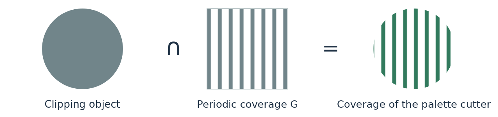
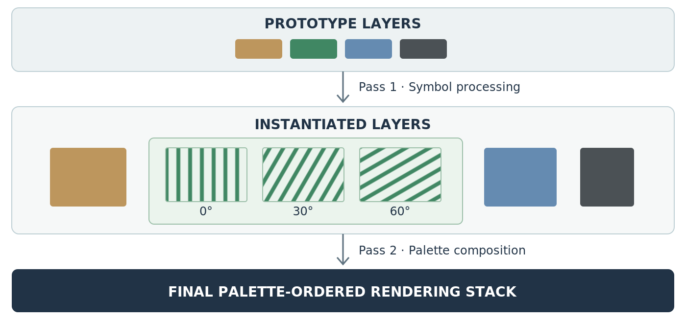
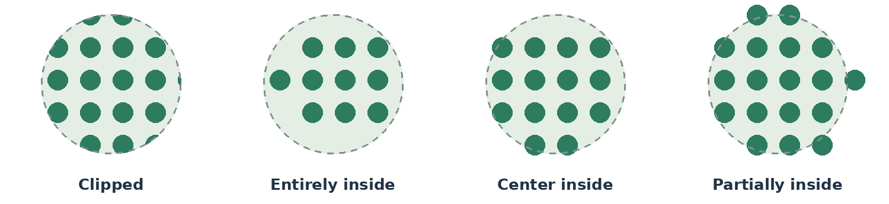

# Palette-layer vector graphics architecture

> This is a working document converted from `Palette_Layer_Vector_Graphics_Specification_Revised.docx` on Nov 17, 2026.
> This text was written again on Nov 21, 2026, in the terms of [Glossary.md](Glossary.md) and by the structure of the passes (@Pauli, Nov 21).
> This specification was never the basis of NotPurplePen. Rather this is the reference for an architecture change of upstream's map model, to be later on integrated into NotPurplePen. Where NotPurplePen already knows how to take the model further, this specification does not bind as such, and the knowledge can be used to develop this specification further.
> By default, the branch feature/multiply-blending is the oracle of this work (@Pauli, Nov 17).
> That branch is an oracle of the appearance only, not a model of the implementation. The goal of this work is the architecture that this specification separates: pass 1 makes the instances, and pass 2 composites them. feature/multiply-blending gets its appearance in another way: it blends an ink as a layer around the drawing of the symbols. Where this specification leaves room to do the same, the room is not meant. The work does not read the code of that branch (@Pauli, Nov 18).
> OCAD and OpenOrienteering Mapper are the authorities on how their own maps render. For Mapper maps, Mapper is an oracle of the appearance: this architecture may organize the vector structure in its own way, but where Mapper implements the function, the result must look as Mapper draws it, except where we find a bug in Mapper (@Pauli, Nov 17).

Design specification / Cartographic rendering

**A generalized vector model of palette separations, with symbol-driven layer instantiation of affine-transformed periodic coverages and compositing in palette order.**

This architecture is intended for application within a surrounding system design. It captures the essential rendering architecture of OCAD and OpenOrienteering Mapper (OOM) in terms that the channels Skia, PDF and SVG can express. It is independent of the color space. The transparency flattening is a separate optimization task.

[Glossary.md](Glossary.md) gives the names of the concepts: the name in the code, which is the primary name, and the Finnish and the English term. [Progress.md](Progress.md) gives the decisions of the work with their dates. The oracles of the appearance, with their sources and measurements, are in [oracles/](oracles/).

## Relationship to OCAD and OOM

Both applications draw by a table of colors in priority order, and not only by the drawing order of complete objects. Each element of a symbol adds geometry to its own color. In its PDF export, OCAD applies a blend mode to each color. OOM simulates the overprinting of the spot colors. Both applications can turn and move the patterns of each object. [1–5]

| Cartographic concept | In this architecture |
|---|---|
| Color table and color priority | The palette colors (`SymColor`) in palette order: the palette stack |
| Symbol elements | The clipping objects of the palette color coverages of the symbols (`SymbolCoverage`) |
| Solid area fills | The full coverage G = 1 |
| Hatched and structured area fills | The periodic coverage G of a hatching or of an area pattern, or the elements that a fill mode selects |
| Pattern offset and orientation | The affine transformation M of a configuration, from the lattice transformation L and the element transformation E |
| Opacity / alpha and blend mode | The opacity α and the blend mode B of the palette color, which pass 2 applies once to its transparency group |
| Overprint (OCAD) / knockout (OOM) | Inverse terms for the printing behavior, apart from α |

## Scope of equivalence

The architecture keeps the palette color apart from the ink. It supports the direct compositing of the colors and the ink separations. RGB and CMYK are representations of a color, and not properties of a coverage. [1, 2, 4]

## 01 / The structure of the passes

The architecture has three parts: the map side, the intermediate layer that pass 1 makes from the map, and the rendering side. Sections 02, 03 and 04 give the three parts. This section gives the whole.

### The units

| Unit | Part | Role |
|---|---|---|
| `Map` | Map side | The source. It keeps the ideal forms. |
| `SymColor`, palette color | Map side | The color C, the opacity α, the blend mode B, the knockout, the ink components and the priority. |
| `CoveragePrototype`, coverage prototype | Map side | The coverage G in its origin-bound form: the full coverage, a hatching or an area pattern of a `SymDef`. |
| `Symbol`, symbol | Map side | One object of a map, with its symbol key (`Symbol.Key`). |
| `SymbolCoverage`, palette color coverage of a symbol | Intermediate layer | The coverage of one `Symbol` in one palette color with one G: the triple (`Symbol`, `SymColor`, G). |
| `PaletteSeparation`, palette separation | Intermediate layer | The palette color coverages of the symbols in one palette color. |
| `PaletteCutter`, palette cutter | Intermediate layer | The palette color coverages of the symbols in one palette separation that have the same configuration. |
| `ClippingObject`, clipping object | Intermediate layer | A derived value that limits the extent over which G applies. |
| Transparency group of a palette color | Rendering side | The group that pass 2 composites for one palette color. |
| Encoding | Rendering side | It writes the drawing for one channel. |

### The coverage and the color

A palette color takes part in the drawing only where its coverage is. A coverage is binary: a point of the plane is in the coverage, or it is not. The coverage of a palette cutter is G under M inside the union of its clipping objects. The clipping objects give no color and no alpha. The color C, the opacity α and the blend mode B belong to the palette color alone.



Figure 1. A clipping object limits the extent of the periodic coverage G. The coverage that results stays binary.

In compositing, the alpha has two parts: the coverage and the opacity. This architecture keeps them apart. G and the clipping objects give the binary coverage, and the opacity α is a property of the palette color.

### The two passes

**Pass 1, layer instantiation.** `Map` makes the palette separations of the palette color coverages of the symbols, and their palette cutters, from the map alone. Pass 1 takes no rectangle and no resolution of a drawing. The symbol definitions give the derived values of the palette color coverages of their symbols.

**Pass 2, layer composition.** Pass 2 takes the palette separations in palette order. For each palette separation, an encoding writes the transparency group of its palette color. C, α and B apply once to the group. Pass 2 does not call the drawing code of the symbols (`Draw`).



Figure 2. Pass 1 makes a palette separation for each palette color, and in it a palette cutter for each configuration: here, the green hatching has three configurations. Pass 2 composites the transparency groups of the palette colors in palette order.

### The rules of the structure

- `Map` is the source. It keeps in its ideal form the information that an encoding needs: the palette colors in palette order, the symbol definitions with their parts, the symbols with their geometry in paper coordinates, and the metric that the source means to be used.
- The intermediate layer is not source data. `Map` makes it from the map, and `Map` stays the source.
- When an encoding needs information, `Map` keeps it, and the intermediate layer gives access to it in forms that are more usable for the needs of the channels. The encoding recognizes no structure.
- `Map` offers the known channel conversions as the means to make derived values from its ideal forms. `Map` keeps a derived value where the shared use of the channels or a cache of the results makes it sensible.
- The palette colors of a map are drawn by pass 2 only. The normal view is a rendering mode of pass 2, as the simulated overprinting and the ink separations are.
- An encoding writes its channel directly. `IGraphicsTarget` stays beside the palette stack, and it draws what does not belong to the palette stack.
- One palette stack is for all the maps, the courses included.
- The coverages and the compositing of the colors are at different levels of the architecture. The number of palette cutters can grow apart from the number of palette colors. The inks are independent of both.

---

# The text of Nov 17

This is the text of Nov 17, with @Pauli's notes of Nov 18 to 20. The sections above replace it part by part, and the last part of the work removes it. Until then, the section and figure numbers that the other documents give refer to this text.

Design specification / Cartographic rendering

**A generalized vector color-separation model with symbol-driven instantiation of affine-transformed periodic geometry and palette-ordered compositing.**

The model is intended for application within a surrounding system design. It captures the essential rendering architecture of OCAD and OpenOrienteering Mapper (OOM) in SVG-compatible terms, with color-space independence and a separate optimization task for vector transparency flattening.

## Relationship to OCAD and OOM

Both applications organize rendering by a prioritized color table, rather than simply by the drawing order of complete objects. Symbol elements contribute geometry to their respective colors. OCAD supports color-specific blend modes for PDF export; OOM supports spot-color overprinting simulation. Both have object-specific pattern orientation facilities. [1–5]

| Cartographic concept              | Corresponding model                                            |
|-----------------------------------|----------------------------------------------------------------|
| Color table and color priority    | Ordered palette entries / compositing layers                   |
| Symbol elements                   | Graphical clipping objects                                     |
| Solid area fills                  | Constant repetitive geometry G = 1                             |
| Hatched and structured area fills | Periodic geometry G, or instantiated clipping objects          |
| Pattern offset and orientation    | Per-instance affine transformations of lattice and element     |
| Opacity / alpha and blend mode    | Independent palette-entry compositing properties               |
| Overprint (OCAD) / knockout (OOM) | Inverse terminology for printing behavior; separate from alpha |

## Scope of equivalence

The architecture distinguishes palette identity from ink identity. It supports direct color compositing and ink-based color separations. RGB and CMYK are color representations, not geometry properties. [1, 2, 4]

References: [\[1\] OCAD: Colors](https://www.ocad.com/wiki/ocad/en/index.php?title=Colors) • [\[2\] OCAD: Blend Mode](https://www.ocad.com/wiki/ocad/en/index.php?title=Blend_Mode) • [\[3\] OCAD: Area Symbols](https://www.ocad.com/wiki/ocad/en/index.php?title=Create_a_New_Area_Symbol) • [\[4\] OOM: Color Window](https://www.openorienteering.org/mapper-manual/pages/color_dock_widget.html) • [\[5\] OOM: Pattern Rotation](https://github.com/OpenOrienteering/mapper/wiki/Notes-on-.ocd-format-and-Mapper-compatibility)

## 01 / Logical model: Palette layers and geometry

The drawing comprises an ordered stack of palette layers. In the initial single-instance model a layer is described by the following properties. Ink and knockout semantics extend the palette definition independently of geometry (section 06).

| Property           | Meaning                                                         |
|--------------------|-----------------------------------------------------------------|
| C — Color          | Spatially constant color, independent of color space.           |
| α — Alpha          | Spatially constant opacity.                                     |
| B — Blend mode     | Compositing operation.                                          |
| G — Geometry       | Binary, spatially repetitive, origin-bound geometry selector.   |
| M — Transformation | Invertible 2D affine transformation of G; defaults to identity. |

G determines whether the layer participates at a given position. Color and alpha belong exclusively to the palette layer. Patterns are instances of repetitive geometry, not independent paint functions or additional rendering properties.

Full coverage is G(x, y) = 1, the constant case of repetitive geometry. An opaque default layer with full coverage is an ordinary instance of the architecture, not a special architectural component.

### Geometry transformations

Each instance can independently translate, rotate, scale, shear or reflect its geometry. Translation and rotation are currently required; the model admits all invertible 2D affine transformations. Lattice and element transformations are distinguished in section 03.

For a point p in the drawing coordinate system, the effective periodic selector is G(M⁻¹p). The prototype is origin-bound; its affine transformation is relative to the global coordinate system. The binary and repetitive character of G is preserved, and constant G = 1 is invariant.

Independently transformed repetitive geometries need not share a common repeating unit.

### Clipping objects

Graphical clipping objects determine the spatial extent over which the respective periodic geometry applies. They do not supply separate color or alpha. Multiple clipping objects associated with the same instance contribute their combined coverage by union.


Figure 1. A clipping object limits the extent of repetitive geometry. The effective coverage remains binary.

## 02 / Extended architecture: Symbol-driven layer instantiation

Object-specific pattern offsets and rotations require implicit instantiation of patterned layers, not duplication of the original geometry prototypes. The final layer setup is determined by symbols and individual map objects, including independently rotated patterned elements.


Figure 2. Symbol processing derives instances from prototypes; composition follows the palette order.

### Two-pass architecture

**Pass 1 — Layer instantiation.** Process symbols and individual map objects. Instantiate each required combination of palette entry, geometry prototype and effective lattice/element transformations; associate its clipping objects. Equivalent configurations may share an instance.

**Pass 2 — Layer composition.** Group instances by palette entry and composite the color separations in palette-priority order under the selected color configuration.

| Entity             | Properties / role                                                   |
|--------------------|---------------------------------------------------------------------|
| Palette entry      | Color, alpha, blend mode, knockout, ink contributions and priority. |
| Geometry prototype | Reusable origin-bound periodic geometry G.                          |
| Layer instance     | Palette and prototype references; effective affine transformations. |
| Clipping object    | Vector geometry associated with a layer instance.                   |

Geometry instantiation and color compositing occur at different architectural levels. The number of instances can grow independently of the number of palette entries. Ink identity is independent of both.

> **The structure of the passes (@Pauli, Nov 20).** This structure replaces the entities of the table above where they do not agree with it. The names are the names of the code, as [Glossary.md](Glossary.md) gives them, and the glossary marks the names that are not decided.
>
> - **The source.** `Map` keeps in its ideal form the information that an encoding needs: the palette colors (`SymColor`) in palette order, the symbol definitions (`SymDef`) with their parts, the symbols (`Symbol`) with their geometry in paper coordinates, and the metric that the source means to be used.
> - **The palette color coverage of a symbol** (`SymbolCoverage`) is the coverage of one `Symbol` in one palette color with one coverage prototype G: the triple (`Symbol`, `SymColor`, G). G is the full coverage, or one hatching or one pattern of the `SymDef`. A palette color coverage of a symbol refers to these objects and copies nothing.
> - **The palette separation** (`PaletteSeparation`) is the palette color coverages of the symbols in one palette color.
> - **The palette cutter** (`PaletteCutter`) is the palette color coverages of the symbols in one palette separation that have the same configuration: the palette color, G and the effective affine transformation M. M comes from the `Symbol` and from G. The palette cutter cuts the uniform color of the palette color to the coverage that G under M gives inside the union of its clipping objects. Each palette color coverage of a symbol is in one palette cutter. The palette cutter is the layer instance of the table above.
> - **Pass 1.** `Map` makes the palette separations and their palette cutters from the map alone.
> - **The derived values.** `Map` offers the known channel conversions as means to make derived values from its ideal forms for the needs of the channels. It keeps a derived value where the shared use of the channels or a cache of the results makes it sensible. A derived value is not an ideal form, but a practical adaptation of it: its form depends on what the implementations that the channels choose need, for example Bezier pieces, polylines or both. A palette color coverage of a symbol keeps its own derived values, for example the parts of a line, the fitted dash patterns, the runs of dashes in the euclidean measure, the offset curves, the placements and the elements that a fill mode selects. A derived value that depends on a definition alone belongs to the definition, for example the shared shapes of a glyph. A palette separation keeps its palette cutters. A derived value is calculated when it is necessary the first time, and it becomes invalid when the map changes. `Map` stays the source.
> - **Pass 2** takes the palette separations in palette order. For each palette separation, an encoding writes the transparency group of its palette color, to which C, α and B apply once. In the group, the encoding writes each palette cutter with one fill and one clip, or each palette color coverage of a symbol separately. Pass 2 does not call the drawing code of the symbols (`Draw`).
> - **The encodings.** An encoding chooses the channel conversions of `Map` that its channel can use. With channel conversions of its own, it makes only what no channel conversion of `Map` covers, and it does not keep their results. When an encoding needs information, `Map` keeps it, and the intermediate layer gives access to it in forms that are more usable for the needs of the channels. The encoding recognizes no structure ([000](tickets/000-palette-layers.md)).
> - **The files.** A self-supporting SVG or PDF file carries the content of `Map`, so that it can be opened as a map. Its drawn objects link directly to the parts of the content of `Map`, also through the hierarchy of the file, so that the SVG graphics can be a part of a web user interface. A drawn object can take the geometry that it draws by reference from the shared parts of the intermediate layer. The link and the reuse are different references, and they do not limit each other.

## 03 / Geometry instantiation: Structured fills and transformations

OCAD and OOM distinguish clipped structured fills from modes that select complete pattern elements according to their relationship with an area. The distinction is resolved during symbol-driven instantiation, not in the palette compositing model. [3, 5] The center of an element is its origin, the point that the lattice places at a lattice vector.



Figure 3. Boundary modes: clip elements, or select complete elements that are entirely inside, centered inside or partially inside the area.

Clipped structured fills retain implicit repetitive geometry through SVG pattern fills. Selectively placed complete elements are instantiated as individual clipping objects. Nonperiodic structured fills likewise become individual clipping objects. Composite representations of selected elements are deferred to later refinement.

> **The patterns in the structure of the passes (@Pauli, Nov 20).** A hatching or a pattern of an `AreaSymDef` is a coverage prototype G (section 02). M comes from the angle and the rotation center of the `AreaSymbol` (`Angle`, `RotationCenter`) and from the angle and the offset of G; `RotateMode.Never` leaves out the part of the `AreaSymbol`. The clipping objects of a clipped fill are the areas of the palette color coverages of the symbols in a palette cutter. The elements that a fill mode selects, and the placements of the elements of an irregular pattern, are derived values of a palette color coverage of a symbol. The randomness of an irregular pattern is kept as a definition.

### Independent lattice and element transformations

The repetition lattice and the repeated geometry within it can be transformed independently. OCAD distinguishes rotation of the arrangement from rotation of its elements. [3]

The element transformation E applies in the drawing's frame, to each element about its own lattice point: the point e of the element at lattice vector v lies at L(v) + E(e), where L is the lattice transformation. In OCAD, the structure angle of the symbol turns the lattice alone, and the angle of an area object turns the lattice and its elements together.


Figure 4. The lattice can rotate independently of its elements; both can also rotate together.

Effective transformations may vary by symbol, individual map object and its patterned elements. Instantiate additional layers for each previously unrepresented configuration, including individually rotated elements, rather than only per symbol. Equivalent configurations may reuse an instance; palette-level compositing is unchanged.

## 04 / SVG encoding: Reusable definitions and instances

The model can be expressed using existing SVG primitives. These are alternative encoding mechanisms for the same underlying logical model, rather than distinctions in the graphics architecture itself.

| Logical property          | SVG representation                                           |
|---------------------------|--------------------------------------------------------------|
| Uniform color layers      | Filled rectangles                                            |
| Binary geometry selectors | Clipping paths                                               |
| Repetitive geometry       | Origin-bound, single-color pattern fills with unpainted gaps |
| Affine transformations    | patternTransform                                             |
| Layer transparency        | Opacity                                                      |
| Layer blending            | Blend modes (mix-blend-mode)                                 |

SVG pattern references can inherit reusable definitions while overriding selected attributes. A transformed pattern instance therefore requires only a reference and its transformation, not a duplicate of the prototype geometry. [6–7]

```xml
<defs>
  <!-- Prototype: one definition of the repetitive geometry -->
  <pattern id="hatch" patternUnits="userSpaceOnUse"
           width="8" height="8">
    <rect width="2" height="8" fill="#008000"/>
  </pattern>

  <!-- Instances reference the prototype -->
  <pattern id="hatch-30" href="#hatch"
           patternTransform="rotate(30)"/>
  <pattern id="hatch-60" href="#hatch"
           patternTransform="rotate(60)"/>
  <pattern id="hatch-offset" href="#hatch"
           patternTransform="translate(2 4)"/>
</defs>
```


Figure 5. Pattern definitions share one prototype; instances independently determine phase and orientation.

A pattern is used as a paint server in SVG, but logically represents repetitive binary coverage. Pattern gaps are unpainted. A pattern fill inside a clipPath does not itself define repeated clipping coverage; the clipped paint element is used instead.

References: [\[6\] MDN: pattern](https://developer.mozilla.org/en-US/docs/Web/SVG/Reference/Element/pattern) • [\[7\] MDN: patternTransform](https://developer.mozilla.org/en-US/docs/Web/SVG/Reference/Attribute/patternTransform) • [\[8\] MDN: clipPath](https://developer.mozilla.org/en-US/docs/Web/SVG/Reference/Element/clipPath)

## 05 / Compositing semantics: One compositing layer per palette entry

Distinct instances sharing a palette entry collectively define its binary coverage by union. In direct-color compositing, the palette color, alpha and blend mode apply once to that coverage, not independently to each instance. Ink-based operations are a separate concern (section 06).


Figure 6. The overlap of two instances of one palette entry must not receive that entry’s alpha twice. Solid coverage isolates the compositing principle.

For direct RGB compositing, SVG groups instances painted with the entry’s opaque color and applies opacity and blending to the group. The example assumes that the referenced clipping paths are defined. [9–10]

```xml
<g id="palette-green" opacity="0.6"
   style="mix-blend-mode:multiply">
  <rect width="100%" height="100%"
        fill="url(#hatch)"
        clip-path="url(#geometry-1)"/>
  <rect width="100%" height="100%"
        fill="url(#hatch-30)"
        clip-path="url(#geometry-2)"/>
  <rect width="100%" height="100%"
        fill="url(#hatch-60)"
        clip-path="url(#geometry-3)"/>
</g>
```

The complete palette stack may be isolated using isolation: isolate to constrain its blending to the drawing. Antialiasing of boundaries is a rendering concern, not a property of the logical binary coverage model.

### Consequence for flattening

Overlaps among instances sharing a palette entry do not themselves introduce new compositing operations or new overlap colors. Their geometric relationships can remain implicit until needed; no explicit vector union is required merely to render the group.

> **The union can stay implicit in the rendering, but the instances cannot be left out** (@Pauli, Nov 18). The paragraph above relates mainly to the flattening (section 08), as its heading says. It does not let the instances be left out. The group of a palette entry is its instances, which pass 1 makes (section 02), and pass 2 reads the instances only. To draw the shapes of a palette entry into one layer while the symbols are drawn, and to apply α and B to that layer, gives the same appearance, but not this architecture.

> **The group of a palette color (@Pauli, Nov 20).** In the structure of the passes (section 02), the content of the transparency group of a palette color is its palette separation, and pass 2 reads the palette separations. This replaces the instances in the note above.

SVG examples describe the encoding mechanisms; their behavior across different rendering engines has not been tested in this specification.

References: [\[9\] MDN: SVG opacity](https://developer.mozilla.org/en-US/docs/Web/SVG/Reference/Attribute/opacity) • [\[10\] W3C: Compositing and Blending](https://www.w3.org/TR/compositing-1/)

## 06 / Color and ink model: Ink identity and color-space independence

Ink is a colorant identity distinct from palette identity. A palette entry may reference one ink at a specified percentage, a mixture of inks, or a direct color. CMYK process colors form a four-ink case of the generalized ink model; spot inks extend it. RGB describes direct color or simulated appearance. [1, 4]

| Entity             | Role                                                                  |
|--------------------|-----------------------------------------------------------------------|
| Ink                | Independent printing colorant identity and color definition.          |
| Palette entry      | Color or ink contributions; alpha, blend mode, knockout and priority. |
| Geometry prototype | Reusable origin-bound periodic geometry.                              |
| Layer instance     | Palette/prototype references and effective transformations.           |
| Clipping object    | Vector coverage associated with an instance.                          |

### Non-idempotent blending

Prototype reuse avoids geometry duplication. Collective compositing prevents repeated application of a palette entry. Neither alone resolves shared inks across different palette entries. For example, cyan in a green ink mixture and cyan in a blue entry should be resolved within the same ink separation before mixing with other inks.


Figure 7. Illustrative comparison: overlapping cyan-plus-yellow green and cyan blue; the ink-based example assumes overprinting preserves yellow. Colors are not color-managed simulations.

### Knockout and overprint

OCAD opacity corresponds to alpha. OCAD’s process-color Overprint flag and OOM’s Knockout flag convey inverse printing intent: preserve or remove underlying inks. Keep knockout distinct from opacity and blend mode. OCAD spot separations additionally distinguish an undefined ink contribution (leave unchanged), 0% (erase), and a specified positive percentage (set coverage). [1, 4, 12–13]

References: [\[12\] OCAD: Export Files](https://www.ocad.com/wiki/ocad/en/index.php?title=Export_Files) • [\[13\] OOM: Overprint export discussion](https://github.com/OpenOrienteering/mapper/issues/2228)

## 07 / Color representation: Color serialization and rendering modes

### Color-space independence

The logical color model is independent of color space. Support RGB, CMYK and spot ink compositions without changing the geometry architecture. Preserve explicit CMYK components during SVG serialization where applicable, with an RGB representation for display. OOM similarly distinguishes desktop RGB, process CMYK and spot ink settings. [4]

### SVG compatibility for CMYK

SVG 1.1 supports ICC-based color definitions alongside an sRGB fallback. Inkscape documents this representation; Scribus documents importing four-component ICC colors as CMYK without applying the referenced profile. Compatibility depends on the renderer and version. [14–16]

```xml
<defs>
  <color-profile name="print-cmyk"
                 xlink:href="print-profile.icc"/>
</defs>
<rect width="100%" height="100%"
      fill="#009933 icc-color(print-cmyk, 1, 0, 1, 0)"
      clip-path="url(#green-geometry)"/>
```

Illustrative fragment: the surrounding SVG must declare the xlink namespace and supply the actual ICC profile and clipping geometry. The RGB fallback is illustrative, not a profile-derived conversion. Some browsers reject ICC paint declarations instead of displaying the fallback. CMYK serialization alone does not implement ink-aware overprinting.

### Rendering-mode independence

The instantiated geometry is independent of the color compositing configuration. The same geometry can serve normal editing views, simulated overprinting, physical ink separations or transparency-flattened vector output. This is an architectural capability, not a prescription of rendering-mode implementations. OCAD distinguishes normal view and print-related color behavior; OOM provides overprint simulation. [2, 4, 11]

In an ink-aware flattened output, preserve computed CMYK or ink values where relevant rather than necessarily converting an RGB simulation back into ink components.

The SVG fragments are illustrative. Their combined behavior in Inkscape, Scribus and browser rendering engines has not been tested.

References: [\[14\] W3C: SVG 1.1 Painting](https://www.w3.org/TR/SVG11/painting.html#SpecifyingPaint) • [\[15\] Inkscape: ICC color support](https://wiki.inkscape.org/wiki/Release_notes/0.46) • [\[16\] Scribus: SVG import](https://sources.debian.org/data/non-free/s/scribus-doc/1.4.8%2Bdfsg-1/doc/de/scribus-svg.html)

## 08 / Optimization specification: Vector transparency flattening

The task is to determine an optimal strategy for flattening the transparencies of this configuration into opaque vector objects while preserving the composited appearance. The architecture is a given design constraint; flattening is a separate optimization task.

At any position, clipping objects and transformed periodic geometry determine the participating palette entries. Their uniform color and compositing properties are evaluated in palette order, using the selected color configuration. The resulting opaque colors must be associated with corresponding vector geometry.


Figure 8. Two overlapping palette separations can produce three different opaque color regions in addition to the default color. This illustrates the task, not a prescribed output organization.

### Primary objective — geometric computation cost

Minimize the computational cost arising from geometric intersection calculations during transparency flattening. Consider the number and complexity of geometric operations, redundant calculations, intermediate and derived geometry, and unnecessary expansion of repetitive geometry. Counting intersections alone is insufficient, since the cost of individual operations can vary substantially.

### Secondary objective — output representation size

Minimize the total encoded size of the flattened vector drawing, including palette colors, geometry, references and repetitive definitions. Output compactness is desirable, but subordinate to minimizing geometric computation cost.

### Mandatory constraints and scope

Flattening must take place entirely in the vector domain. Rasterization, raster sampling, resolution-dependent geometry processing and reconstruction from raster data are excluded. The output must remain resolution-independent and preserve the original composited appearance and spatial alignment.

No particular partitioning method, intersection algorithm or output organization is prescribed. Exhaustive enumeration of all possible layer combinations is not a viable general strategy because of exponential growth. The choice of algorithm remains open.

OOM advertises overprinting simulation for raster output; the objective here is to derive the flattened appearance as vector objects. [11]

References: [\[11\] OpenOrienteering Mapper: features](https://www.openorienteering.org/apps/mapper/)
