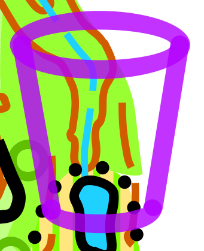

# Mapper's opacity of a color: where Mapper is not the oracle

Nov 18, 2026. For a Mapper map, Mapper is the oracle of the appearance, except where the work finds a bug in Mapper
(the preface of [Specification.md](../Specification.md)). This file records such a case. Mapper applies the opacity of
a color to each shape, and not once to the palette entry, as section 05 and figure 6 of the specification require.

## The source

[mapper-opacity/lordhill-cup.png](mapper-opacity/lordhill-cup.png) is a screenshot of Mapper's normal view that
@Pauli took on Nov 18. It shows the map LordHill with its own palette, as in
`src/MapModel/TestFiles/openmapper/LordHill.omap`, which is `rendering/LordHill.ocd` as Mapper opened and saved it. The
color "Purple" has the opacity 0.8, from the transparency `t80` of the OCAD file. To test it, @Pauli placed on the map
an object of the symbol "Refreshment point" (611.0), a drinking cup in Purple. The files in the repository have the
symbol, but no object of it. The cup is made of shapes that overlap: the rim, the sides and the base.

## The colors

Mapper shows Purple, C30 M100 Y0 K0, as the RGB 179, 0, 255.

| Where | In the screenshot | 0.8 of Purple over it, once | Twice: 0.96 of Purple |
| --- | --- | --- | --- |
| One shape over white | 194, 51, 255 | 194, 51, 255 | 182, 10, 255 |
| Two shapes over white | 182, 10, 255 | 194, 51, 255 | 182, 10, 255 |
| One shape over green (153, 255, 51) | 174, 51, 214 | 174, 51, 214 | 178, 10, 247 |
| Two shapes over green | 178, 10, 247 | 174, 51, 214 | 178, 10, 247 |
| One shape over black | 143, 0, 204 | 143, 0, 204 | 172, 0, 245 |

## What the oracle tells

- Mapper paints each shape of a color with the alpha of the opacity of the color, over what is below the shape. Where
  two shapes of one color overlap, the alpha applies twice, and the overlap is darker: 1 − 0.2² = 0.96 of Purple, and
  not 0.8.
- It is not multiply. Multiply of the color of one shape with itself would give 148, 10, 255.
- Section 05 of the specification applies α once to the union of the instances of a palette entry, and figure 6 shows
  this case. So Mapper is not the oracle of α where the shapes of one color overlap. Where they do not overlap, Mapper
  is the oracle: 0.8 of the color over what is below it.

## Where the work uses it

- **Pass 2, the composition by palette entry.** A criterion for its ticket: a test places an object of the symbol
  "Refreshment point" (611.0) on `LordHill.omap` and on `LordHill.ocd`. The overlap of the shapes of the cup has the
  color of one shape, because the composition applies α = 0.8 once to the group of Purple.
