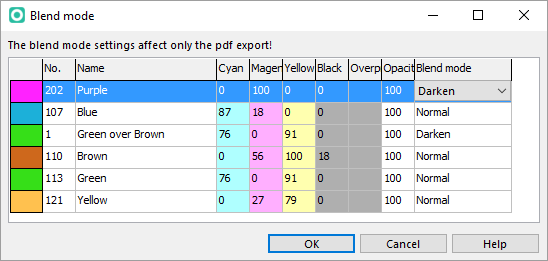
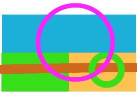
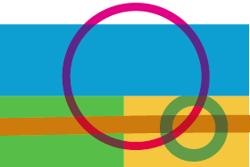

# OCAD's blend mode Darken: an oracle

Nov 18, 2026. OCAD is the authority on how its own maps render (the preface of
[Specification.md](../Specification.md)). This oracle tells how OCAD applies the blend mode Darken, B of section 02.
Its source is the OCAD wiki page [Blend Mode](https://www.ocad.com/wiki/ocad/en/index.php?title=Blend_Mode): its text,
the table of its Blend mode dialog (`BlendModeTable.png`), OCAD's own view (`BlendModeOcad.png`), and the exported PDF
in Adobe Reader (`BlendModePdf.png`). @Pauli gave them on Nov 18. The images are in [ocad-darken/](ocad-darken/),
under the names that the wiki gives them.

## The example

Six colors, the top one first. Each has the opacity 100, and none overprints.

| Number | Name | C | M | Y | K | Blend mode |
| --- | --- | --- | --- | --- | --- | --- |
| 202 | Purple | 0 | 100 | 0 | 0 | Darken |
| 107 | Blue | 87 | 18 | 0 | 0 | Normal |
| 1 | Green over Brown | 76 | 0 | 91 | 0 | Darken |
| 110 | Brown | 0 | 56 | 100 | 18 | Normal |
| 113 | Green | 76 | 0 | 91 | 0 | Normal |
| 121 | Yellow | 0 | 27 | 79 | 0 | Normal |

The drawing has white paper at the top and a band of Blue below it. Below the band, Green is at the left and Yellow
at the right, and a road of Brown crosses both. A ring of Purple lies over the paper, Blue, Green, the road and
Yellow. A ring of Green over Brown lies over Yellow and the road.

## What the images show

First OCAD's own view, and then the PDF in Adobe Reader.

- OCAD's own view does not apply the blend mode: each ring covers what is below it. The dialog says so too: "The
  blend mode settings affect only the pdf export!"
- In the PDF, a ring with Darken mixes with what is below it.
- The two images do not share a color conversion. OCAD's view is a screenshot in RGB from OCAD's own conversion, and
  the PDF image is the CMYK of the PDF, which Adobe Reader converted. So the colors of one image are compared only
  with each other. OCAD's view gives the shapes, and shows that Green over Brown and Green have the same color.

## The colors of the PDF

RGB from the PDF image; inks in percent.

| The ring over | The color below, alone | The ring there | The larger share of each ink | The RGB minimum |
| --- | --- | --- | --- | --- |
| Purple over the paper | 255, 255, 255 | 225, 0, 133 | C0 M100 Y0 K0 | 225, 0, 133 |
| Purple over Blue | 13, 159, 209 | 91, 39, 136 | C87 M100 Y0 K0 | 13, 0, 133 |
| Purple over Green | 87, 191, 71 | 111, 57, 61 | C76 M100 Y91 K0 | 87, 0, 71 |
| Purple over Brown | 205, 123, 13 | 197, 15, 38 | C0 M100 Y100 K18 | 205, 0, 13 |
| Purple over Yellow | 244, 199, 63 | 226, 6, 63 | C0 M100 Y79 K0 | 225, 0, 63 |
| Green over Brown over Yellow | 244, 199, 63 | 99, 156, 70 | C76 M27 Y91 K0 | 87, 191, 63 |
| Green over Brown over Brown | 205, 123, 13 | 90, 102, 50 | C76 M56 Y100 K18 | 87, 123, 13 |

Green over Brown is not alone anywhere in the PDF image. Its RGB minimum uses the color of Green, which has the same
CMYK value.

## What the oracle tells

- Darken in OCAD's PDF is not the minimum of each RGB channel. A channel of an RGB minimum is not above that channel of
  either color. But the ring of Purple over Blue has red 91, where Blue has 13, and over Green it has green 57, where
  Purple has 0. The colors alone and the blends are in the same image, so this holds for any conversion of the image.
- Darken in OCAD's PDF agrees with the larger share of each ink, in CMYK, converted to RGB after the blend. The CMYK
  profile FOGRA45L (littleCMS, relative colorimetric) converts the colors alone to their RGB in the image within 23 in
  each channel, and the larger shares of the inks to the blends within 36. The RGB minimum is off by up to 78.
- So OCAD blends Darken by inks (sections 02 and 04), and not by direct colors (section 04).

## Where the work uses it

1. **Pass 2, the composition by palette entry.** For an OCAD map, B = Darken is the larger share of each ink where an
   entry with Darken lies over the entries below it. A test of pass 2 can check this in the model, apart from the
   rendering, with the exact values of the dialog: Purple over Blue is C87 M100 Y0 K0, and Green over Brown over Brown
   is C76 M56 Y100 K18. The inks of a palette entry are its `InkComponents` ([ticket 001](../tickets/001-inks.md)).
2. **The rendering modes.** OCAD applies B only in its PDF export, and not in its own view. The ticket of the rendering
   modes decides which modes of Purple Pen apply B, and this oracle gives the appearance of each. The overprint effect
   of Purple Pen blends with the Darken of the drawing target, which is the RGB minimum in Skia, so it is not OCAD's
   Darken: over Blue, the RGB minimum is 13, 0, 133, and OCAD's PDF is 91, 39, 136.
3. **A test map.** The example has six colors, two bands, a road and two rings, and no text. A test map with the same
   colors and shapes gives pass 2 the regions above, each with its expected inks.
4. **[Ticket 004](../tickets/004-opacity-and-blend-mode.md).** The dialog calls the field `t` "Opacity", and names the
   blend modes as the files do: Normal and Darken.

## Limits

- The CMYK profile of Adobe Reader is not known, and FOGRA45L is not it. The RGB values of this oracle are approximate;
  the CMYK values of the dialog are exact.
- The example has no Multiply, and no opacity below 100.
