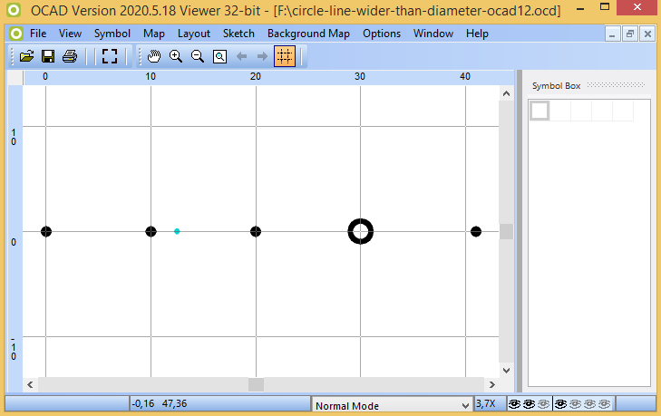
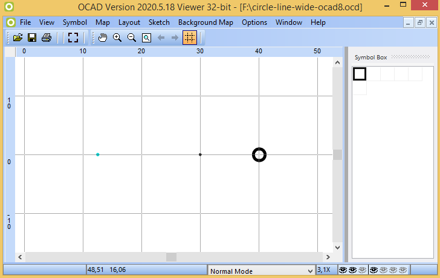

# OCAD's circle whose line is as wide as its diameter or wider

Nov 18, 2026. OCAD is the authority on how its own maps render (the preface of [Specification.md](../Specification.md)).
This file records how OCAD, Mapper and Purple Pen draw the circle element of a point symbol whose line is at least as
wide as its diameter. OCAD 9 and later write the diameter of a circle element from the middle of its line, and OCAD 6
to 8 write it from the outer edges of the line.

## The source

Purple Pen wrote three files on Nov 18, with `InputOutput.WriteFile` in temporary tests, at the scale 1:10 000. Each
has point symbols in a row on the paper, with one circle element each, at its origin unless the table tells
otherwise.

| File | Symbol, at x on the paper | The circle element in the file |
| --- | --- | --- |
| [OCAD 9](ocad-thick-circles/circle-line-wider-than-diameter-ocad9.ocd) and [OCAD 12](ocad-thick-circles/circle-line-wider-than-diameter-ocad12.ocd), diameters from the middle | A, 0 mm | diameter 1.0 mm, line 1.5 mm |
| | B, 10 mm | as A, and a blue filled circle of 0.5 mm at (2.5, 0) mm |
| | C, 20 mm | diameter 1.0 mm, line 1.0 mm |
| | D, 30 mm | diameter 2.0 mm, line 0.5 mm |
| | E, 40 mm | as A, with its center 1 mm to the right of the origin |
| [OCAD 8](ocad-thick-circles/circle-line-wide-ocad8.ocd), diameters from the outer edges | A8, 0 mm | diameter 1.0 mm, line 1.5 mm |
| | B8, 10 mm | as A8, and a blue filled circle of 0.5 mm at (2.5, 0) mm |
| | C8, 20 mm | diameter 1.0 mm, line 1.0 mm |
| | F8, 30 mm | diameter 1.0 mm, line 0.6 mm |
| | D8, 40 mm | diameter 2.5 mm, line 0.5 mm |
| | E8, 50 mm | as A8, with its center 1 mm to the right of the origin |

@Pauli took the screenshots on Nov 18: OCAD 2020.5.18 Viewer
([OCAD 9](ocad-thick-circles/ocad-viewer-ocad9.png), [OCAD 12](ocad-thick-circles/ocad-viewer-ocad12.png),
[OCAD 8](ocad-thick-circles/ocad-viewer-ocad8.png)) and OpenOrienteering Mapper 0.9.7
([OCAD 9](ocad-thick-circles/mapper-ocad9.png), [OCAD 12](ocad-thick-circles/mapper-ocad12.png)). The view of Mapper
shows the whole area that the drawing covers. The temporary tests drew the files with the code of upstream d48f4456
and Skia, at 0.05 mm to the pixel: [OCAD 12](ocad-thick-circles/purple-pen.png) and
[OCAD 8](ocad-thick-circles/purple-pen-ocad8.png).

## The values

In the screenshots of the OCAD 9 and 12 files, at the zoom 3.7, the grid lines of 0 and 30 mm are 347 pixels apart:
11.6 pixels to the mm. In the screenshot of the OCAD 8 file, at the zoom 3.1, the grid lines are 97 pixels apart:
9.7 pixels to the mm. The OCAD 9 and 12 files draw the same in each program.

| Symbol | Diameter from the middle | OCAD 2020 | Purple Pen, upstream d48f4456 | Mapper 0.9.7 |
| --- | --- | --- | --- | --- |
| A | 1.0, line 1.5 | filled circle, 12 px, about 1.0 mm | filled circle, 1.0 mm | nothing |
| B, the circle | 1.0, line 1.5 | filled circle, 13 px, about 1.0 mm | nothing | nothing |
| C | 1.0, line 1.0 | filled circle, 12 px, about 1.0 mm | nothing | nothing |
| D | 2.0, line 0.5 | ring, 28 to 29 px, 2.5 mm across | ring, 2.5 mm across | ring, 2.5 mm across |
| E | 1.0, line 1.5 | filled circle, 11 to 12 px, about 1.0 mm, its center at 41 mm | nothing | nothing |
| A8 | 1.0 − 1.5 = −0.5 | nothing | filled circle, 1.0 mm | not seen |
| B8, the circle | −0.5 | nothing | nothing | not seen |
| C8 | 1.0 − 1.0 = 0 | nothing | nothing | not seen |
| F8 | 1.0 − 0.6 = 0.4, line 0.6 | filled circle, 5 px, about 0.4 to 0.5 mm | ring of about 1.0 mm with a small hole | not seen |
| D8 | 2.5 − 0.5 = 2.0, line 0.5 | ring, 24 to 25 px, 2.5 mm across | ring, 2.5 mm across | not seen |
| E8 | −0.5 | nothing | nothing | not seen |

## What the oracle tells

- OCAD takes the diameter of a circle element from the middle of the line: in an OCAD 6 to 8 file, it takes the line
  from the diameter. With that diameter, a circle whose diameter is larger than its line is a ring, a circle whose
  line is at least as wide as its diameter is a filled circle of that diameter, and a circle whose diameter is 0 or
  less is not drawn. The line does not change the size of a filled circle: C, with a line of 1.0 mm, is as large as
  A, with a line of 1.5 mm.
- Upstream reads an OCAD 9+ circle with its diameter from the middle when the line is at least as wide, and an OCAD 6
  to 8 circle with its diameter from the outer edges. `Glyph.DrawSimple` fills a lone circle at the origin when its
  line is wider than its diameter, and `GlyphPart.Draw` draws a circle only when its diameter is larger than its line.
  So upstream draws A and A8 as filled circles of 1.0 mm, B, C and E not at all, and F8 as a ring. Ticket
  [015](../tickets/015-thick-glyph-circles.md) makes Purple Pen read, draw and write these circles as OCAD draws them.
- Mapper draws none of the circles A, B, C and E. For an OCAD file, OCAD is the authority, so Mapper is not the oracle
  of them.
- Purple Pen wrote the files. They show how OCAD reads these values, and not whether OCAD writes such circles.
