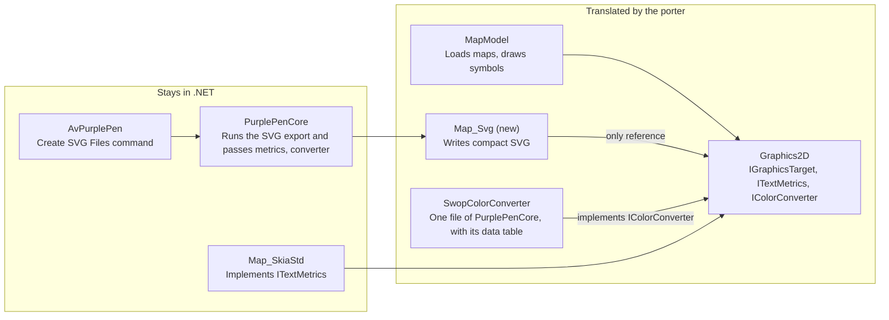

# SVG Graphics Target — Requirements

Oct 21, 2026 · @Pauli

## Purpose and scope

The SVG target is a new implementation of `IGraphicsTarget` that writes a map and its courses as compact SVG. It has two uses: an SVG export in the NotPurplePen application, and the drawing back end of a later TypeScript port of the map code.

| In scope | Out of scope |
| --- | --- |
| The target, as its own project beside `Map_PDF` and `Map_SkiaStd` | Reading or importing SVG |
| An SVG export command and dialog in the Avalonia application | The WinForms application and GDI+ |
| Tests and size reports in GitHub Actions | The porting application, which lives in its own repository |
| Code that the porting application can translate | Display on screen inside the application |

Levels below: **Must** is required for the first release, **Should** is expected unless a stated reason prevents it, **May** is optional.

## Constraints

The target references only `Graphics2D`, so the porting application can translate it with the map model without pulling in any renderer.

| ID | Requirement | Level |
| --- | --- | --- |
| C-1 | The target is its own project, `src/MapModel/Map_Svg`, targeting `net10.0`. | Must |
| C-2 | Its only project reference is `Graphics2D`. It references no Skia, GDI+, PdfSharp or Avalonia code and no package. | Must |
| C-3 | Text measurement, color conversion and bitmap data reach it only through `ITextMetrics`, `IColorConverter` and `IGraphicsBitmap`, passed in by the caller. | Must |
| C-4 | It uses only C# constructs and .NET library calls that the map model already uses, so the porter needs no new rules for it. | Should |
| C-5 | Number formatting is culture-independent: the target formats numbers with its own integer routine. | Must |
| C-6 | Lookup tables are keyed by strings or by object identity, never by structs with custom equality. | Should |
| C-7 | Every class and method has a header comment, and types are explicit instead of `var`, as the repository requires. | Must |
| C-8 | It is built and tested only in GitHub Actions, by pushing a `wip/` branch that merges the feature branch. | Must |
| C-9 | The feature branch carries the target and its Avalonia export command together, since a feature must be reachable in the shipped application. | Must |
| C-10 | Test baselines that this work moves are committed in the same branch. | Must |

Arrows point from a project to the project it references.

MapModel also references DotSpatial for projections; the port replaces it with proj4js (P-2).

## Drawing operations

Every `IGraphicsTarget` call has an SVG equivalent, and the target reports pattern brushes and darken blending as supported. Where behavior is open, it follows `Skia_GraphicsTarget`.

| ID | Requirement | Level |
| --- | --- | --- |
| D-1 | `PushTransform` opens a group whose transform is prepended to the current one; `PopTransform` closes it. | Must |
| D-2 | Each `PushClip` overload becomes a clip path, nested clips intersect, and `PopClip` ends the clipped group. A rectangle array clips to the union of its rectangles. `Alternate` clips use the even-odd rule. | Must |
| D-3 | Path parts map to path commands: `Start` to move, `Lines` to line, `Beziers` to cubic curve, `Close` to close. `Alternate` fills use the even-odd rule, `Winding` fills the nonzero rule. | Must |
| D-4 | Lines, rectangles, ellipses, polygons, polylines and arcs produce the same geometry as the Skia target. Arc angles are in degrees with Skia's orientation. | Must |
| D-5 | Pens carry width, cap and join: `Flat` to butt, `Square` to square, `Round` to round; `Miter` with the pen's miter limit, `Bevel`, `Round`. `MiterClipped` is rejected, as the Skia target rejects it. | Must |
| D-6 | A pen made from a brush key strokes with that brush, including a pattern brush. | Must |
| D-7 | `SupportsPatternBrushes` returns true. `CreatePatternBrush` returns a target that draws one tile; `FinishBrush` turns it into a pattern of the given tile size and angle. The bitmap width and height hints are ignored. | Must |
| D-8 | `PushBlending(Darken)` returns true and blends the enclosed drawing with darken; `PopBlending` ends it. The map uses this for overprinted colors. | Must |
| D-9 | `PushAntiAliasing(false)` renders the enclosed drawing with crisp edges. | Should |
| D-10 | Paths, brushes, pens and fonts are stored by key identity; the `Has` methods report them, and points are copied, never held. | Must |
| D-11 | An intensity below 1.0 scales the CMYK components before conversion, as the Skia target does; setting it discards existing brushes and pens. | Must |
| D-12 | Finishing the document closes every open group. Unbalanced push and pop calls, or any call the target cannot honor, raise an error naming the call. | Must |

## Color

Output colors are sRGB, converted from the map's CMYK by the converter the caller passes in, because no browser supports CMYK colors in CSS ([MDN](https://developer.mozilla.org/en-US/docs/Web/CSS/Reference/Values/color_value/device-cmyk)).

| ID | Requirement | Level |
| --- | --- | --- |
| COL-1 | The export offers the same color models as image export and uses the same converters: `SwopColorConverter` for CMYK, `DefaultColorConverter` for RGB. | Must |
| COL-2 | A color with alpha below 1.0 gets a matching fill or stroke opacity; opaque colors carry no opacity. | Must |
| COL-3 | Colors use the shortest hex notation, three digits when exact. | Should |
| COL-4 | Each color's original CMYK values are recorded once in the document, beside its style, so a print workflow can recover them. | May |
| COL-5 | Overprinting is expressed only through darken blending (D-8), not through any CMYK-specific feature. | Must |

## Text

Text stays text, placed with the same metrics the application uses, so the SVG and the bitmap export put every line in the same place.

| ID | Requirement | Level |
| --- | --- | --- |
| T-1 | `DrawText` writes a text element with the font's family, size, weight and style. Its baseline is the given upper-left point plus the face's `Ascent` from the injected `ITextMetrics`. | Must |
| T-2 | `DrawTextOutline` writes the same text stroked with the pen and not filled. | Must |
| T-3 | Spaces are preserved, and text is escaped for XML. | Must |
| T-4 | Underline and strikeout become text decorations. The Skia target does not draw underline yet. | May |
| T-5 | Single-grapheme draws along a line, each under its own translation and rotation, merge into one text element with per-character positions and rotations when font and brush match. The map draws line text grapheme by grapheme. | Should |
| T-6 | Fonts are referenced by family name. Embedding font subsets needs font file access that no injected interface provides, so it waits for a later release. | Must |

## Bitmaps

Bitmaps are embedded by default, written once each, and can instead be linked as separate files when they would dominate the document's size.

| ID | Requirement | Level |
| --- | --- | --- |
| B-1 | `DrawBitmap` places an image over the given rectangle. `DrawBitmapPart` places the cropped part. | Must |
| B-2 | `NearestNeighbor` scaling renders pixelated; the other modes render smooth. | Must |
| B-3 | Images are written through `WriteToStream`, in their original format when it is PNG or JPEG, otherwise as PNG. JPEG quality comes from the export settings. | Must |
| B-4 | The export setting chooses one of three handlings: embedded as data, linked as files beside the SVG, or left out. Embedding is the default. Embedded data grows by a third in base64, which compression barely recovers. | Must |
| B-5 | A bitmap, or the same part of one, drawn more than once is written once and referenced. | Must |

## Output compactness

Size is the target's main design goal: integer coordinates, styles and symbols written once, and merged paths, before any compression.

| ID | Requirement | Level |
| --- | --- | --- |
| S-1 | Coordinates and widths are integers in a quantization unit, with one scale from that unit to millimetres at the root. The default step is 0.01 mm, OCAD's own resolution, so geometry imported from OCAD keeps its exact values. The step is an export setting. | Must |
| S-2 | Values that scale with distance, such as angles, scale factors and font sizes, keep enough digits that the resulting position error stays below one step over the extent they apply to. | Must |
| S-3 | Path data uses the shortest valid encoding: relative or absolute per command, whichever is shorter, implicit command repetition, and no separator before a minus sign. | Must |
| S-4 | Styles are classes in one style block, named by the shortest free names and shared by value: two pens of the same color and width share one class. Elements carry only a class and their geometry. | Must |
| S-5 | A drawing sequence repeated under different translations and rotations, such as a point symbol, is defined once and placed by reference. Repeats are found by comparing the written fragment as a string. | Must |
| S-6 | Consecutive draws with the same style, and no transform, clip or blending change between them, merge into one path when the result renders the same within the fidelity tolerance (F-1). Opaque strokes always merge. Opaque fills merge when their bounds are disjoint, or when each is one contour under the nonzero rule, turned to the same orientation. Translucent colors never merge. | Must |
| S-7 | The export draws area patterns as pattern brushes instead of clipped copies of every pattern element. `MapDisplay` turns pattern brushes off when printing, and when drawing antialiased below a minimum resolution of 0.007, so the export needs a way to request them. | Must |
| S-8 | A transform is written as a translation, rotation or scale when it is one, and as a matrix only otherwise. Groups open only to carry an attribute, and adjacent groups combine where their attribute order allows. | Must |
| S-9 | Elements are separated by single line breaks, with no indentation, comments, default-valued attributes or editor metadata. A line per element keeps baseline diffs readable for about one byte per element. | Must |
| S-10 | The export can write the document gzip-compressed, as `.svgz`. | Should |

## Fidelity and determinism

The SVG must look like the Skia export and come out byte for byte the same on every run; the second property makes text baselines and the TypeScript comparison possible.

| ID | Requirement | Level |
| --- | --- | --- |
| F-1 | Rasterized by the reference renderer, the SVG matches the Skia bitmap export of the same map, area and settings, compared with the existing `CompareBitmapBaseline` within a pixel tolerance. | Must |
| F-2 | The same input gives byte-identical output on every run, machine and platform: no time stamps, ids and class names assigned in order of first use, nothing ordered by hash. | Must |
| F-3 | The output is well-formed XML and valid SVG. It uses only `svg`, `g`, `defs`, `style`, `path`, `circle`, `ellipse`, `use`, `clipPath`, `pattern`, `text` and `image`, with references through plain `href`. | Must |
| F-4 | The root's width and height are the print area in millimetres at the course's print scale, so the document prints at the intended scale. | Must |
| F-5 | Current Chromium, Firefox and WebKit display the output correctly, darken blending included, and Inkscape opens it. | Should |

## Application integration

An SVG export command joins Create OCAD Files and Create Image Files in the File menu and reuses image export's handling of courses.

| ID | Requirement | Level |
| --- | --- | --- |
| A-1 | A Create SVG Files command sits in the File menu beside Create Image Files and opens its own Avalonia dialog, built to the repository's dialog conventions. | Must |
| A-2 | A settings class, `SvgCreationSettings`, holds image export's course, variation, map exchange, base map, color model, directory and prefix fields, plus the quantization step, bitmap handling, JPEG quality and compression. It has no DPI or world file. | Must |
| A-3 | File list, file names, print areas and course layout are those of image export: one file per course designator, named by `QueryEvent.CreateOutputFileName`, covering `GetCurrentPrintAreaRectangle`. Code shared with `BitmapCreation` is factored out, not copied. | Must |
| A-4 | The export draws through `MapDisplay` with a minimum resolution equal to the quantization step, so nothing is simplified below the output's precision. | Must |
| A-5 | The target receives the map's own `TextMetricsProvider` and the converter from COL-1, so the application is the only place where the target meets Skia. | Must |
| A-6 | Files about to be overwritten are listed for confirmation first, and the chosen settings are kept until another map loads, as image export does. | Must |
| A-7 | New interface strings go into `UIText.resx`, which has no SVG strings yet. | Must |

## Verification

Every requirement above is checked in GitHub Actions on the `wip/` branch; a requirement no test checks counts as unverified.

| ID | Requirement | Level |
| --- | --- | --- |
| V-1 | A new NUnit project, `Map_Svg.Tests`, checks the SVG written for each drawing operation against expected text, including the errors of D-12. | Must |
| V-2 | Baseline tests export a selected set of reference maps from the test folders and compare the SVG text with committed baselines. The set covers OCAD and OpenMapper maps, area patterns, text along lines, bitmaps and overprinted colors. | Must |
| V-3 | Fidelity tests rasterize the same exports with the reference renderer and compare them with the Skia bitmaps (F-1). | Must |
| V-4 | Each baseline test exports twice and requires identical bytes. The baseline tests also run on Linux, so identity across platforms is checked, not assumed. Today's test job runs only on Windows on ARM. | Must |
| V-5 | The job summary reports each reference map's SVG size, plain and gzip-compressed, so size changes show up in review. | Must |
| V-6 | A browser check renders the reference SVGs in Chromium, Firefox and WebKit (F-5). | Should |

## Relation to the TypeScript port

The porting application translates `Graphics2D`, `MapModel` and `Map_Svg` from a pinned commit of the fork, so this target becomes the drawing back end of the TypeScript port.

| ID | Requirement | Level |
| --- | --- | --- |
| P-1 | The porter starts from map loading and SVG export and translates what they reach. The OCAD and OpenMapper exporters stay out unless something reaches them. | Must |
| P-2 | DotSpatial is not translated. The port calls proj4js, the npm package [`proj4`](https://www.npmjs.com/package/proj4), which accepts Proj4 strings, in place of the `ProjectionUtil` calls that map import makes. The table of OCAD projection ids in `OcadToProj4Projection` translates as ordinary code. | Must |
| P-3 | Values that pass through projection math are compared within a tolerance, since proj4js and DotSpatial compute them independently. | Must |
| P-4 | `SwopColorConverter` lives in `PurplePenCore` and reads the embedded resource `swopsamples.dat`. The port needs it, with that data file, for CMYK output to match. | Must |
| P-5 | The comparison harness records every text metrics query of the .NET export and replays the answers to the TypeScript run, keeping measurement differences apart from translation errors. | Must |
| P-6 | With metrics replayed, the TypeScript export of a reference map equals the .NET export byte for byte (F-2). The only allowed difference is one unit in a value whose last-bit rounding differs between the runtimes. | Must |

## Open decisions

Six choices remain open; none blocks starting on the target itself.

| Decision | Options | Affects |
| --- | --- | --- |
| Branch root | `upstream/master` if the target is to be offered to Purple Pen, otherwise `dev` | C-8, C-9 |
| Reference renderer | A .NET rasterizer as a test-only dependency, or headless browsers, which would also cover F-5 | F-1, V-3, V-6 |
| Requesting pattern brushes | A new `MapDisplay` setting, or choosing by the target's `SupportsPatternBrushes` | S-7 |
| Quantization step for OpenMapper maps | A fixed 0.01 mm, or 0.001 mm chosen from the source format | S-1 |
| Form of the recorded CMYK values | A comment, a data attribute, or a CSS custom property per style | COL-4 |
| Georeferencing | None, or the map's coordinate reference and offsets as metadata for web map use | A-2 |
