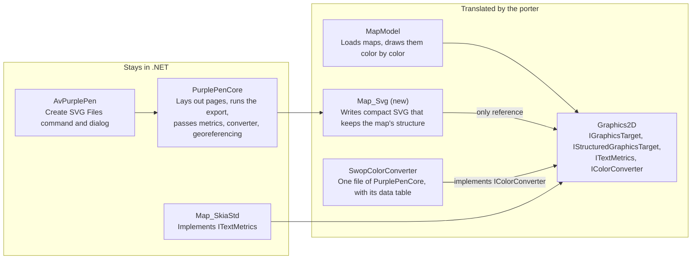

# SVG Graphics Target — Requirements

Oct 21, 2026 · @Pauli

## Purpose and scope

The SVG target is a new implementation of `IGraphicsTarget` that writes a map and its courses as compact SVG. The SVG is a map in its own right: every element traces back to the map object, symbol, color and map it came from, and the document carries the map's color table, symbol table and georeferencing. The target has two uses: an SVG export in the NotPurplePen application, built so that it can be offered to Purple Pen, and the drawing back end of a later TypeScript port of the map code.

| In scope | Out of scope |
| --- | --- |
| The target, as its own project beside `Map_PDF` and `Map_SkiaStd` | Reading or importing SVG |
| Calls through which the map code tells the target its maps, color runs and objects | Course semantics, such as control codes, legs and course lists |
| An SVG export command with its own dialog in the Avalonia application | The WinForms application and GDI+ |
| CMYK colors that Inkscape and Scribus read, beside sRGB for browsers | Copying a PDF base map as vectors, as PDF export does |
| Tests and size reports in GitHub Actions | Display on screen inside the application |
| Code that the porting application can translate | The porting application, which lives in its own repository |

Levels below: **Must** is required in the release that the delivery plan gives it, **Should** is expected unless a stated reason prevents it, **May** is optional.

## Delivery

The first release is the SVG export: the quickest result anyone can use, and small enough to offer to Purple Pen as it stands. Later releases make the output smaller and prove it against Skia and the browsers, and the TypeScript port builds on them.

| Phase | Work | Release |
| --- | --- | --- |
| 1 | Drawing operations (D), map structure (M), color (COL), georeferencing (G), compactness S-1 to S-4, S-8, S-9 and S-11, determinism and validity (F-2 to F-4, F-6) | First |
| 2 | The export in the application (A) and its tests (V-1, V-2, V-4, V-5, V-7, V-8) | First |
| 3 | Text (T) and bitmaps (B) | First |
| 4 | Symbol reuse, path merging, pattern brushes and compression (S-5 to S-7, S-10) | Later |
| 5 | Fidelity against Skia and browser checks (F-1, F-5, V-3, V-6) | Later |
| 6 | The TypeScript port (P) | Later, in its own repository |

## Constraints

The target references only `Graphics2D`, so the porting application can translate it with the map model without pulling in any renderer.

| ID | Requirement | Level |
| --- | --- | --- |
| C-1 | The target is its own project, `src/MapModel/Map_Svg`, targeting `net10.0`. | Must |
| C-2 | Its only project reference is `Graphics2D`. It references no Skia, GDI+, PdfSharp or Avalonia code and no package. | Must |
| C-3 | Text measurement, color conversion, bitmap data and georeferencing reach it only through `ITextMetrics`, `IColorConverter`, `IGraphicsBitmap` and plain values, passed in by the caller. | Must |
| C-4 | It uses only C# constructs and .NET library calls that the map model already uses, so the porter needs no new rules for it. | Should |
| C-5 | Number formatting is culture-independent: the target formats numbers with its own routine. | Must |
| C-6 | Lookup tables are keyed by strings or by object identity, never by structs with custom equality. | Should |
| C-7 | Every class and method has a header comment, and types are explicit instead of `var`, as the repository requires. | Must |
| C-8 | The feature branch is rooted at `upstream/master`, so that it can be offered to Purple Pen as it stands. It is built and tested only in GitHub Actions, through a `wip/` branch rooted at `base` that merges it. | Must |
| C-9 | The feature branch carries the target, the map code's structure calls and the Avalonia export together, since a feature must be reachable in the shipped application. | Must |
| C-10 | Test baselines that this work moves are committed in the same branch. | Must |

Arrows point from a project to the project it references.

MapModel also references DotSpatial for projections; the port replaces it with proj4js (P-2).

## Map structure

A map's layering is its color table. `Map.Draw` draws one color at a time from the bottom of the table up, and each object draws only its parts in that color; `MapDisplay` places the course between map colors by drawing ranges of colors. The target keeps that order and is told where each map, color run and object begins, so every element it writes traces back to the object, symbol, color and map it came from.

| ID | Requirement | Level |
| --- | --- | --- |
| M-1 | Elements are written in the order of the drawing calls. No optimization moves a draw past another, so the document keeps the map's layering. | Must |
| M-2 | A new interface in `Graphics2D`, `IStructuredGraphicsTarget`, carries the calls below. The map code makes them only to a target that implements it, so every other target is unaffected. | Must |
| M-3 | `Map.DrawColor` opens a color run before the first object it draws in a color and closes it after the last. It passes the color as a key, with its position in the color table, its name, its CMYK values and its overprint flag. A color with nothing to draw opens no run. | Must |
| M-4 | Around each object, `Map.DrawColor` passes the object and its symbol definition as keys, with the symbol's id and name. | Must |
| M-5 | Every run belongs to a map: `MapDisplay` labels the base map and the course map, and `Map` labels each template with its file name. Drawing outside `Map.DrawColor`, such as a bitmap base map or an image template, sits under its map's label outside any run. | Must |
| M-6 | Within a run, consecutive objects of one symbol share a group, and each object's elements carry its number. Objects are numbered in the order they are first drawn, so an object drawn in several colors has the same number in each of its runs. | Must |
| M-7 | The metadata holds, once each, a color table (map, position, name, CMYK values, overprint flag) and a symbol table (id, name, colors). Runs, symbol groups and objects refer to them, so any element traces back to its object, symbol, color and map. | Must |
| M-8 | The structure is always written; no setting removes it. | Must |

## Drawing operations

Every `IGraphicsTarget` call has an SVG equivalent, and the target reports pattern brushes and darken blending as supported. Where behavior is open, it follows `Skia_GraphicsTarget`.

| ID | Requirement | Level |
| --- | --- | --- |
| D-1 | `PushTransform` opens a group whose transform is prepended to the current one; `PopTransform` closes it. | Must |
| D-2 | Each `PushClip` overload becomes a clip path, nested clips intersect, and `PopClip` ends the clipped group. A rectangle array clips to the union of its rectangles. `Alternate` clips use the even-odd rule. | Must |
| D-3 | Path parts map to path commands: `Start` to move, `Lines` to line, `Beziers` to cubic curve, `Close` to close. `Alternate` fills use the even-odd rule, `Winding` fills the nonzero rule. | Must |
| D-4 | Lines, rectangles, ellipses, polygons, polylines and arcs produce the same geometry as the Skia target. Arc angles are in degrees with Skia's orientation. | Must |
| D-5 | Pens carry width, cap and join: `Flat` to butt, `Square` to square, `Round` to round; `Miter` with the pen's miter limit, `Bevel`, `Round`. `MiterClipped` is rejected, as the Skia target rejects it. | Must |
| D-6 | A pen made from a brush key strokes with that brush, including a pattern brush. | Must |
| D-7 | `SupportsPatternBrushes` returns true. `CreatePatternBrush` returns a target that draws one tile; `FinishBrush` turns it into a pattern of the given tile size and angle. The bitmap width and height hints are ignored. | Must |
| D-8 | `PushBlending(Darken)` returns true and blends the enclosed drawing with darken; `PopBlending` ends it. The map uses this for overprinted colors. | Must |
| D-9 | `PushAntiAliasing(false)` renders the enclosed drawing with crisp edges. | Should |
| D-10 | Paths, brushes, pens and fonts are stored by key identity; the `Has` methods report them, and points are copied, never held. | Must |
| D-11 | An intensity below 1.0 scales the CMYK components before conversion, as the Skia target does; setting it discards existing brushes and pens. | Must |
| D-12 | Finishing the document closes every open group. Unbalanced push and pop calls or structure calls, or any call the target cannot honor, raise an error naming the call. | Must |

## Color

Colors keep the map's CMYK values. No browser supports CMYK colors in CSS ([MDN](https://developer.mozilla.org/en-US/docs/Web/CSS/Reference/Values/color_value/device-cmyk)), while Inkscape and Scribus read CMYK written as SVG 1.1 `icc-color()` ([Libre Arts](https://librearts.org/2011/09/how-to-get-cmyk-colors-from-inkscape-to-scribus/)), so each style carries both: sRGB for browsers, and the CMYK values for print tools.

| ID | Requirement | Level |
| --- | --- | --- |
| COL-1 | Under the CMYK color model, each style declares its color twice: first as plain sRGB, then as the same sRGB followed by `icc-color()` with the CMYK values. A reader that rejects the second declaration keeps the first. | Must |
| COL-2 | The sRGB value comes from the converter for the chosen color model: `SwopColorConverter` for CMYK, `DefaultColorConverter` for RGB. Under the RGB model the styles carry sRGB only; the color table (M-7) keeps the CMYK values under either model. | Must |
| COL-3 | `icc-color()` names one CMYK profile, declared once in the document, so that tools treat the values as CMYK. | Must |
| COL-4 | CMYK values are written with the fewest digits that reproduce the values the map stores; OCAD's binary formats store half-percent steps. | Must |
| COL-5 | A color with alpha below 1.0 gets a matching fill or stroke opacity; opaque colors carry no opacity. | Must |
| COL-6 | sRGB values use the shortest hex notation, three digits when exact. | Should |
| COL-7 | On screen, overprinting is shown through darken blending (D-8); the overprint flag itself travels in the color table (M-7). | Must |

## Georeferencing

When the map has real-world coordinates, the document records them, so that a reader can place the map on a web map. They are the coordinates that image export writes into world files, together with the coordinate system, which a world file does not carry.

| ID | Requirement | Level |
| --- | --- | --- |
| G-1 | When the map has real-world coordinates, the metadata records the affine transform from the document's map coordinates to real-world coordinates, computed with the `CoordinateMapper` that image export uses for world files. | Must |
| G-2 | The metadata records the coordinate system: the map's EPSG code when it has one, otherwise its Proj4 string, otherwise its OCAD grid and zone id. | Must |

## Text

Text stays text, placed with the same metrics the application uses, so the SVG and the bitmap export put every line in the same place.

| ID | Requirement | Level |
| --- | --- | --- |
| T-1 | `DrawText` writes a text element with the font's family, size, weight and style. Its baseline is the given upper-left point plus the face's `Ascent` from the injected `ITextMetrics`. | Must |
| T-2 | `DrawTextOutline` writes the same text stroked with the pen and not filled. | Must |
| T-3 | Spaces are preserved, and text is escaped for XML. | Must |
| T-4 | Underline and strikeout become text decorations. The Skia target does not draw underline yet. | May |
| T-5 | Single-grapheme draws along a line, each under its own translation and rotation, merge into one text element with per-character positions and rotations when they belong to one object and share font and brush. The map draws line text grapheme by grapheme. | Should |
| T-6 | Fonts are referenced by family name. Embedding font subsets needs font file access that no injected interface provides, so it waits for a later release. | Must |

## Bitmaps

Bitmaps are embedded by default, written once each, and can instead be linked as separate files when they would dominate the document's size.

| ID | Requirement | Level |
| --- | --- | --- |
| B-1 | `DrawBitmap` places an image over the given rectangle. `DrawBitmapPart` places the cropped part. | Must |
| B-2 | `NearestNeighbor` scaling renders pixelated; the other modes render smooth. | Must |
| B-3 | Images are written through `WriteToStream`, in their original format when it is PNG or JPEG, otherwise as PNG. JPEG quality comes from the export settings. | Must |
| B-4 | The export setting chooses one of three handlings: embedded as data, linked as files beside the SVG, or left out. Embedding is the default. Embedded data grows by a third in base64, which compression barely recovers. | Must |
| B-5 | A bitmap, or the same part of one, drawn more than once is written once and referenced. | Must |
| B-6 | A bitmap drawn at an intensity below 1.0 raises an error naming the call (D-12), since the allowed elements (F-3) cannot lighten an image. The export always draws at full intensity. | Must |

## Output compactness

Size is the target's main design goal after the map structure: integer coordinates, styles and symbols written once, and merged paths, before any compression.

| ID | Requirement | Level |
| --- | --- | --- |
| S-1 | Coordinates and widths inside the map are integers in a quantization step of map millimetres, under the page transform (A-4). The default step is 0.01 mm, OCAD's own resolution, so geometry imported from OCAD keeps its exact values. The step is an export setting. | Must |
| S-2 | Values that scale with distance, such as angles, scale factors and font sizes, keep enough digits that the resulting position error stays below one step over the extent they apply to. | Must |
| S-3 | Path data uses the shortest valid encoding: relative or absolute per command, whichever is shorter, implicit command repetition, and no separator before a minus sign. | Must |
| S-4 | Styles are classes in one style block, named by the shortest free names and shared by value: two pens of the same color and width share one class. Elements carry only a class, their geometry and their object number. | Must |
| S-5 | One color's part of a point symbol, repeated under different translations and rotations, is defined once and placed by reference, one reference per object. Repeats are found by comparing the written fragment as a string. | Must |
| S-6 | Consecutive draws of one object with the same style, and no transform, clip or blending change between them, merge into one path when the result renders the same within the fidelity tolerance (F-1). Opaque strokes always merge. Opaque fills merge when their bounds are disjoint, or when each is one contour under the nonzero rule, turned to the same orientation. Translucent colors never merge, and draws of different objects never merge (M-6). | Must |
| S-7 | Area patterns that the map draws as regular patterns in clip mode become pattern brushes. The export requests them regardless of `MapDisplay`'s own rule, which turns them off when printing and when drawing antialiased below a minimum resolution of 0.007. The map code lets a target whose brushes are vectors skip its pixelation check, which at a minimum resolution of 0.01 mm refuses any tile wider or taller than 0.8 mm. Irregular patterns, and patterns not in clip mode, are drawn element by element. | Must |
| S-8 | A transform is written as a translation, rotation or scale when it is one, and as a matrix only otherwise. Groups open only to carry an attribute, and adjacent groups combine where their attributes and order allow. | Must |
| S-9 | Elements are separated by single line breaks, with no indentation, comments, default-valued attributes or editor metadata. A line per element keeps baseline diffs readable for about one byte per element. | Must |
| S-10 | The export can write the document gzip-compressed, as `.svgz`. | Should |
| S-11 | Identity is written at the coarsest level that carries it: map, run and symbol on groups, the object number on elements. Bounding boxes and anchor points are not written, since a reader computes them from the geometry. | Must |

## Fidelity and determinism

The SVG must look like the Skia export and come out byte for byte the same on every run; the second property makes text baselines and the TypeScript comparison possible.

| ID | Requirement | Level |
| --- | --- | --- |
| F-1 | Rasterized by the reference renderer, the SVG matches the Skia bitmap export of the same map, area and settings, compared with the existing `CompareBitmapBaseline` within a pixel tolerance. | Must |
| F-2 | The same input gives byte-identical output on every run, machine and platform: no time stamps; ids, class names and object numbers assigned in order of first use; nothing ordered by hash. | Must |
| F-3 | The output is well-formed XML. It uses only `svg`, `g`, `defs`, `style`, `metadata`, `color-profile`, `path`, `circle`, `ellipse`, `use`, `clipPath`, `pattern`, `text` and `image`. References go through `xlink:href`, which SVG 1.1 tools need and browsers accept. Identity goes in `data-` attributes, and the tables go in the metadata, in the export's own XML namespace. | Must |
| F-4 | Each file is one page of PDF export's layout: the root's width and height are the page's paper size in millimetres, turned for a landscape page, and the map fills the page's print rectangle at the course's print scale, so the document prints as the PDF page does. | Must |
| F-5 | Current Chromium, Firefox and WebKit display the output correctly, darken blending included. | Should |
| F-6 | Inkscape and Scribus open the output and read each color's CMYK values from it. | Must |

## Application integration

An SVG export command, with a dialog of its own, writes pages laid out as PDF export lays them out.

| ID | Requirement | Level |
| --- | --- | --- |
| A-1 | A Create SVG Files command sits in the File menu next to the PDF commands and opens its own Avalonia dialog, built to the repository's dialog conventions. | Must |
| A-2 | A settings class, `CourseSvgSettings`, holds the course, variation, map exchange, base map, control description, crop, color model, directory and prefix fields of PDF export's settings, with CMYK as the default color model, plus the quantization step, bitmap handling, JPEG quality and compression. | Must |
| A-3 | Pages are laid out by `CoursePageLayout` as for PDF export, and each page is one file, named by `QueryEvent.CreateOutputFileName`; when a course part needs several pages, its files carry the page number as a suffix. Code shared with `CoursePdf` is factored out, not copied. | Must |
| A-4 | Each page is drawn as PDF export draws it: clipped to the page's print rectangle, with the map transformed into it, through `MapDisplay`, at a minimum resolution equal to the quantization step, so nothing is simplified below the output's precision. | Must |
| A-5 | The target receives the map's own `TextMetricsProvider`, the converter from COL-2 and the georeferencing values of G-1 and G-2, so the application is the only place where the target meets Skia. | Must |
| A-6 | Files about to be overwritten are listed for confirmation first, and the chosen settings are kept until another map loads, as PDF export does. | Must |
| A-7 | New interface strings go into `UIText.resx`, which has no SVG strings yet. | Must |

## Verification

Every requirement above is checked in GitHub Actions on the `wip/` branch; a requirement no test checks counts as unverified.

| ID | Requirement | Level |
| --- | --- | --- |
| V-1 | A new NUnit project, `Map_Svg.Tests`, checks the SVG written for each drawing operation and structure call against expected text, including the errors of D-12. | Must |
| V-2 | Baseline tests export a selected set of reference maps from the test folders and compare the SVG text with committed baselines. The set covers OCAD and OpenMapper maps, multi-colored point symbols, area patterns, text along lines, bitmaps, overprinted colors and a georeferenced map. | Must |
| V-3 | Fidelity tests rasterize the same exports with the reference renderer and compare them with the Skia bitmaps (F-1). | Must |
| V-4 | Each baseline test exports twice and requires identical bytes. The baseline tests also run on Linux, so identity across platforms is checked, not assumed. Today's test job runs only on Windows on ARM. | Must |
| V-5 | The job summary reports each reference map's SVG size, plain and gzip-compressed, so size changes show up in review. | Must |
| V-6 | A browser check renders the reference SVGs in Chromium, Firefox and WebKit (F-5). | Should |
| V-7 | A Linux job opens a reference SVG in Inkscape and in Scribus from the command line, reads its colors back and compares their CMYK values with the map's (F-6). | Must |
| V-8 | A structure test walks each reference export, traces every element to its map, color, symbol and object in the tables, and checks that an object drawn in several colors has the same number in all its runs (M-6, M-7). | Must |

## Relation to the TypeScript port

The porting application translates `Graphics2D`, `MapModel` and `Map_Svg` from a pinned commit of the fork, so this target becomes the drawing back end of the TypeScript port.

| ID | Requirement | Level |
| --- | --- | --- |
| P-1 | The porter starts from map loading and SVG export and translates what they reach. The OCAD and OpenMapper exporters stay out unless something reaches them. | Must |
| P-2 | DotSpatial is not translated. The port calls proj4js, the npm package [`proj4`](https://www.npmjs.com/package/proj4), which accepts Proj4 strings, in place of the `ProjectionUtil` calls that map import makes. The table of OCAD projection ids in `OcadToProj4Projection` translates as ordinary code. | Must |
| P-3 | Values that pass through projection math are compared within a tolerance, since proj4js and DotSpatial compute them independently. | Must |
| P-4 | `SwopColorConverter` lives in `PurplePenCore` and reads the embedded resource `swopsamples.dat`. The port needs it, with that data file, for its sRGB values to match. | Must |
| P-5 | The comparison harness records every text metrics query of the .NET export and replays the answers to the TypeScript run, keeping measurement differences apart from translation errors. | Must |
| P-6 | With metrics replayed, the TypeScript export of a reference map equals the .NET export byte for byte (F-2). The only allowed difference is one unit in a value whose last-bit rounding differs between the runtimes. | Must |

## Open decisions

Seven choices remain open; none blocks starting on the target itself.

| Decision | Options | Affects |
| --- | --- | --- |
| Reference renderer | A .NET rasterizer as a test-only dependency, or headless browsers, which would also cover F-5 | F-1, V-3, V-6 |
| Requesting pattern brushes | A render option that the export sets, or a target capability saying its brushes are vectors | S-7 |
| Quantization step for OpenMapper maps | A fixed 0.01 mm, or 0.001 mm chosen from the source format | S-1 |
| CMYK profile | Which profile `icc-color()` names, such as the SWOP profile that also gives the sRGB values, and whether the document refers to it by name or by file | COL-3, V-7 |
| Dialog layout | All settings in view, as in the PDF dialog, or the course list with the other settings behind an Advanced button, as in the Publish Courses dialog | A-1 |
| Namespace of the tables | The fork's own, or Purple Pen's if the export goes upstream | M-7, F-3 |
| The WinForms application | Whether an offer to Purple Pen also needs the command in the WinForms application, if that is still what Purple Pen releases | A-1, C-8 |
