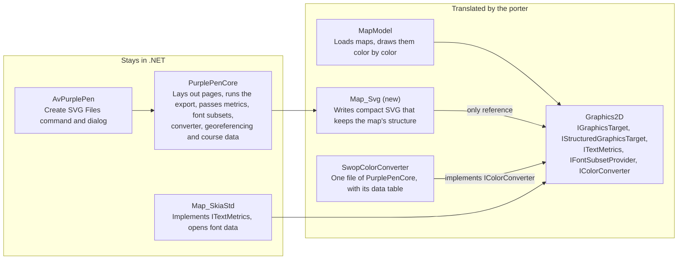

# SVG Graphics Target — Requirements

Oct 21, 2026 · @Pauli

## Purpose and scope

The SVG target is a new implementation of `IGraphicsTarget` that writes maps and their courses as compact SVG. The SVG is a map in its own right: every element traces back to the map object, symbol, color and map it came from, and the document carries each map's color table, symbol table and georeferencing, and the courses it draws. The target has two uses: an SVG export in the NotPurplePen application, built so that it can be offered to Purple Pen, and the drawing back end of a later TypeScript port of the map code.

| In scope | Out of scope |
| --- | --- |
| The target, as its own project beside `Map_PDF` and `Map_SkiaStd` | Reading or importing SVG |
| Calls through which the map code tells the target its maps, color runs and objects | Several maps per event in the application, which Purple Pen does not support yet |
| A layout that holds any number of maps and courses, paired on pages | The WinForms application and GDI+ |
| Course data: each course's controls and legs, and what each course object draws | Copying a PDF base map as vectors, as PDF export does |
| An SVG export command with its own dialog in the Avalonia application | Display on screen inside the application |
| CMYK colors that Inkscape and Scribus read, beside sRGB for browsers | The porting application, which lives in its own repository |
| Tests and size reports in GitHub Actions | Using the development loop for any other work |
| A development loop for this feature, whose results a Claude session reads through git and the GitHub API | |
| Code that the porting application can translate | |

Levels below: **Must** is required in the release that the delivery plan gives it, **Should** is expected unless a stated reason prevents it, **May** is optional.

## Delivery

The first release is the SVG export: the quickest result anyone can use, and small enough to offer to Purple Pen as it stands. It already writes the layout of maps and pages (L), one page per file, so later files keep the same shape. The development loop comes first, so that every later step is checked by it; from then on, the output is judged by how Chromium renders it against Purple Pen's own baseline images. Later releases put several pages in a file, make the output smaller and check it in Firefox and WebKit, and the TypeScript port builds on them. Several maps per file follow when Purple Pen supports several maps per event.

| Phase | Work | Release |
| --- | --- | --- |
| 1 | The development loop (DL), before any code of the target | First |
| 2 | Drawing operations (D), map structure (M), the layout of maps and pages (L-1 to L-5), color (COL), georeferencing (G), compactness S-1 to S-4, S-8, S-9 and S-11, fidelity, determinism and validity (F-1 to F-4, F-6), and the tests that check them (V-1, V-3, V-9) | First |
| 3 | The export in the application (A), writing one page per file, course data (CD) and their tests (V-2, V-4, V-5, V-7) | First |
| 4 | Text (T), with embedded fonts, and bitmaps (B) | First |
| 5 | Several pages per file, with views and Inkscape pages (L-6, L-7, V-8) | Later |
| 6 | Symbol reuse, path merging, pattern brushes and compression (S-5 to S-7, S-10, S-12, S-13) | Later |
| 7 | Firefox and WebKit (F-5, V-6) | Later |
| 8 | The TypeScript port (P) | Later, in its own repository |

## Constraints

The target references only `Graphics2D`, so the porting application can translate it with the map model without pulling in any renderer.

| ID | Requirement | Level |
| --- | --- | --- |
| C-1 | The target is its own project, `src/MapModel/Map_Svg`, targeting `net10.0`. | Must |
| C-2 | Its only project reference is `Graphics2D`. It references no Skia, GDI+, PdfSharp or Avalonia code and no package. | Must |
| C-3 | Text measurement, font data, color conversion, bitmap data, georeferencing and course data reach it only through `ITextMetrics`, `IFontSubsetProvider`, `IColorConverter`, `IGraphicsBitmap` and plain values, passed in by the caller. | Must |
| C-4 | It uses only C# constructs and .NET library calls that the map model already uses, so the porter needs no new rules for it. | Should |
| C-5 | Number formatting is culture-independent: the target formats numbers with its own routine. | Must |
| C-6 | Lookup tables are keyed by strings or by object identity, never by structs with custom equality. | Should |
| C-7 | Every class and method has a header comment, and types are explicit instead of `var`, as the repository requires. | Must |
| C-8 | The feature branch, `feature/svg-target`, is rooted at `upstream/master`, so that it can be offered to Purple Pen as it stands. It is built and tested only in GitHub Actions, through a `wip/` branch rooted at `base` that merges it. | Must |
| C-9 | The feature branch carries the target, the map code's structure calls, the course data and the Avalonia export together, since a feature must be reachable in the shipped application. | Must |
| C-10 | Test baselines that this work moves are committed in the same branch. | Must |

Arrows point from a project to the project it references.

MapModel also references DotSpatial for projections; the port replaces it with proj4js (P-2).

## Map structure

A map's layering is its color table. `Map.Draw` draws one color at a time from the bottom of the table up, and each object draws only its parts in that color; `MapDisplay` places the course between map colors by drawing ranges of colors. The target keeps that order and is told where each map, color run and object begins, so every element it writes traces back to the object, symbol, color and map it came from.

| ID | Requirement | Level |
| --- | --- | --- |
| M-1 | Elements are written in the order of the drawing calls. No optimization moves a draw past another, so the document keeps the map's layering. | Must |
| M-2 | A new interface in `Graphics2D`, `IStructuredGraphicsTarget`, carries the calls below and those that build the layout of maps and pages (L). The map code makes them only to a target that implements it, so every other target is unaffected. | Must |
| M-3 | `Map.DrawColor` opens a color run before the first object it draws in a color and closes it after the last. It passes the color as a key, with its position in the color table, its name, its CMYK values and its overprint flag. A color with nothing to draw opens no run. | Must |
| M-4 | Around each object, `Map.DrawColor` passes the object and its symbol definition as keys, with the symbol's id and name. | Must |
| M-5 | Every run belongs to a map: the export labels each base map and each course drawing, and `Map` labels each template with its file name. Drawing outside `Map.DrawColor`, such as a bitmap base map or an image template, sits under its map's label outside any run. | Must |
| M-6 | Within a run, consecutive objects of one symbol share a group, and each object's elements carry its number. Objects are numbered in the order they are first drawn, so an object drawn in several colors has the same number in each of its runs. | Must |
| M-7 | For every labeled map (M-5), the metadata holds, once, a color table (position, name, CMYK values, overprint flag) and a symbol table (id, name, colors). Runs, symbol groups and objects refer to the tables of their own map, so any element traces back to its object, symbol, color and map. | Must |
| M-8 | The structure is always written; no setting removes it. | Must |

## Maps, courses and pages

A document holds maps, courses and pages. Each map is written once; each page pairs one map with one course part, or shows a map alone; any page can name any map, so any number of maps and courses fit the same layout. Purple Pen has one map per event today, so the export writes one map per file; several maps per file wait for Purple Pen to support them, and need no change to the layout.

| ID | Requirement | Level |
| --- | --- | --- |
| L-1 | A document holds any number of maps and pages, and its course data any number of courses. Nothing in the layout assumes one map, one course or one page. | Must |
| L-2 | Each map is written once, as a definition of its drawing, in two parts split where the course goes: the colors below the course's lower layer and the colors above it. When the event puts the whole course on top, the map is one part. | Must |
| L-3 | Each page pairs one map with one course part, or shows a map alone. Under the page's clip and transform, it references the map's parts and draws the course part with them: the course's lower layer between the map's two parts, the rest on top. | Must |
| L-4 | The export draws each map once, for the area of all the pages that use it, and then each page; pages share the map's drawing, and each page's clip shows its own print area. | Must |
| L-5 | Ids, class names and object numbers are unique across the document. | Must |
| L-6 | Each page carries a `<view>` of its print area, named after its course part, and an Inkscape page element. The first page lies at the document's own view box, which is the page browsers show. | Must |
| L-7 | The export offers PDF export's file choices: all pages in one file, one file per course, or one file per course part. | Must |

## Drawing operations

Every `IGraphicsTarget` call has an SVG equivalent, and the target reports pattern brushes and darken blending as supported. Where behavior is open, it follows `Skia_GraphicsTarget`.

| ID | Requirement | Level |
| --- | --- | --- |
| D-1 | `PushTransform` opens a group whose transform is prepended to the current one; `PopTransform` closes it. | Must |
| D-2 | Each `PushClip` overload becomes a clip path, nested clips intersect, and `PopClip` ends the clipped group. A rectangle array clips to the union of its rectangles. `Alternate` clips use the even-odd rule. | Must |
| D-3 | Path parts map to path commands: `Start` to move, `Lines` to line, `Beziers` to cubic curve, `Close` to close. `Alternate` fills use the even-odd rule, `Winding` fills the nonzero rule. | Must |
| D-4 | Lines, rectangles, ellipses, polygons, polylines and arcs produce the same geometry as the Skia target. Arc angles are in degrees with Skia's orientation. | Must |
| D-5 | Pens carry width, cap and join: `Flat` to butt, `Square` to square, `Round` to round; `Miter` with the pen's miter limit, `Bevel`, `Round`. `MiterClipped` is rejected, as the Skia target rejects it. | Must |
| D-6 | A pen made from a brush key strokes with that brush, including a pattern brush. | Must |
| D-7 | `SupportsPatternBrushes` returns true. `CreatePatternBrush` returns a target that draws one tile; `FinishBrush` turns it into a pattern of the given tile size and angle. The bitmap width and height hints are ignored. | Must |
| D-8 | `PushBlending(Darken)` returns true and blends the enclosed drawing with darken; `PopBlending` ends it. The map uses this for overprinted colors. | Must |
| D-9 | `PushAntiAliasing(false)` renders the enclosed drawing with crisp edges. | Should |
| D-10 | Paths, brushes, pens and fonts are stored by key identity; the `Has` methods report them, and points are copied, never held. | Must |
| D-11 | An intensity below 1.0 scales the CMYK components before conversion, as the Skia target does; setting it discards existing brushes and pens. | Must |
| D-12 | Finishing the document closes every open group. Unbalanced push and pop calls or structure calls, or any call the target cannot honor, raise an error naming the call. | Must |

## Color

Colors keep the map's CMYK values. No browser supports CMYK colors in CSS ([MDN](https://developer.mozilla.org/en-US/docs/Web/CSS/Reference/Values/color_value/device-cmyk)), while Inkscape and Scribus read CMYK written as SVG 1.1 `icc-color()` ([Libre Arts](https://librearts.org/2011/09/how-to-get-cmyk-colors-from-inkscape-to-scribus/)), so each style carries both: sRGB for browsers, and the CMYK values for print tools.

| ID | Requirement | Level |
| --- | --- | --- |
| COL-1 | Under the CMYK color model, each style declares its color twice: first as plain sRGB, then as the same sRGB followed by `icc-color()` with the CMYK values. A reader that rejects the second declaration keeps the first. | Must |
| COL-2 | The sRGB value comes from the converter for the chosen color model: `SwopColorConverter` for CMYK, `DefaultColorConverter` for RGB. Under the RGB model the styles carry sRGB only; the color table (M-7) keeps the CMYK values under either model. | Must |
| COL-3 | `icc-color()` names a device CMYK profile, declared once in the document: the values are the map's own uncalibrated CMYK, and the document embeds or references no ICC profile. | Must |
| COL-4 | CMYK values are written with the fewest digits that reproduce the values the map stores; OCAD's binary formats store half-percent steps. | Must |
| COL-5 | A color with alpha below 1.0 gets a matching fill or stroke opacity; opaque colors carry no opacity. | Must |
| COL-6 | sRGB values use the shortest hex notation, three digits when exact. | Should |
| COL-7 | On screen, overprinting is shown through darken blending (D-8); the overprint flag itself travels in the color table (M-7). | Must |

## Georeferencing

When a map has real-world coordinates, the document records them with that map, so that a reader can place it on a web map. They are the coordinates that image export writes into world files, together with the coordinate system, which a world file does not carry.

| ID | Requirement | Level |
| --- | --- | --- |
| G-1 | For each map with real-world coordinates, the metadata records the affine transform from the map's coordinates to real-world coordinates, computed with the `CoordinateMapper` that image export uses for world files. | Must |
| G-2 | For each map, the metadata records every identification of its coordinate system that the map has: its EPSG code, its Proj4 string and its OCAD grid and zone id. | Must |
| G-3 | The table of OCAD grid ids in `OcadToProj4Projection` also gives the EPSG code of each grid that has one, so a map georeferenced by an OCAD grid id names its EPSG code too: OCAD grid 6005, ETRS-TM35FIN, is EPSG:3067. | Should |

## Course data

The document describes the courses it draws, so that a reader can use it as an event map: which controls each course visits, and which drawn object is which control or leg. None of this changes the drawing.

| ID | Requirement | Level |
| --- | --- | --- |
| CD-1 | The metadata describes each course the document draws: its name, part and variation, its print scale, its controls in order, each with its code, kind and position, and for each part the map it is drawn on and the pages that show it. | Must |
| CD-2 | Each course object in the drawing carries what it draws: its kind and the controls of CD-1 it belongs to, one for a control circle, start, finish or control number, two for a leg. Objects that belong to no control, such as descriptions and special objects, carry their kind only. | Must |
| CD-3 | `CourseLayout` records which map symbols each course object adds, and the export passes the target a lookup from those objects to their course attributes as plain strings. | Must |

## Text

Text stays text, placed with the same metrics the application uses, so the SVG and the bitmap export put every line in the same place. It carries its fonts, so a browser draws it with the faces the map uses, whatever fonts the device has.

| ID | Requirement | Level |
| --- | --- | --- |
| T-1 | `DrawText` writes a text element with the font's family, size, weight and style. Its baseline is the given upper-left point plus the face's `Ascent` from the injected `ITextMetrics`. | Must |
| T-2 | `DrawTextOutline` writes the same text stroked with the pen and not filled. | Must |
| T-3 | Spaces are preserved, and text is escaped for XML. | Must |
| T-4 | Underline and strikeout become text decorations. The Skia target does not draw underline yet. | May |
| T-5 | Single-grapheme draws along a line, each under its own translation and rotation, merge into one text element with per-character positions and rotations when they belong to one object and share font and brush. The map draws line text grapheme by grapheme. | Should |
| T-6 | Every face the document draws is embedded as an `@font-face` rule in the style block, under the family name the map uses, holding a subset with only the glyphs drawn. Text elements keep the family name, so a tool that ignores `@font-face` finds an installed font of that name. | Must |
| T-7 | The target collects the characters drawn in each face and asks for the subsets at the end of the document through `IFontSubsetProvider`, a new interface in `Graphics2D`. The application implements it: `Map_SkiaStd` already opens each face's font data for shaping, and HarfBuzz's subsetter, which the native library HarfBuzzSharp ships for shaping carries, cuts them to what shaping the characters needs, without hinting, with a copy of the face's .notdef under each character the face lacks and draws as that box. A browser application implements it with `harfbuzz-subset.wasm` of harfbuzzjs. | Must |
| T-8 | The fallback faces that Skia draws characters from, when the main face lacks them, are embedded too, so the browser draws the same glyphs. | Must |
| T-9 | A face whose font file forbids embedding, in its `fsType` field, is referenced by name only. | Must |
| T-10 | The rendering comparison (V-3) covers the text cases too, with a tolerance of their own for the way each system draws glyphs. | Must |
| T-11 | A document that draws text names the language of its text as undetermined, `xml:lang="und"` on the root, so that a viewer shapes it as the application does, in no language, and not with the forms a font holds for the language of the reader's locale. | Must |

## Bitmaps

Bitmaps are embedded by default, written once each, and can instead be linked as separate files when they would dominate the document's size.

| ID | Requirement | Level |
| --- | --- | --- |
| B-1 | `DrawBitmap` places an image over the given rectangle. `DrawBitmapPart` places the cropped part. | Must |
| B-2 | `NearestNeighbor` scaling renders pixelated; the other modes render smooth. | Must |
| B-3 | Images are written through `WriteToStream`, in their original format when it is PNG or JPEG, otherwise as PNG. JPEG quality comes from the export settings. | Must |
| B-4 | The export setting chooses one of three handlings: embedded as data, linked as files beside the SVG, or left out. Embedding is the default. Embedded data grows by a third in base64, which compression barely recovers. | Must |
| B-5 | A bitmap, or the same part of one, drawn more than once is written once and referenced. | Must |
| B-6 | A bitmap drawn at an intensity below 1.0 raises an error naming the call (D-12), since the allowed elements (F-3) cannot lighten an image. The export always draws at full intensity. | Must |

## Output compactness

Size is the target's main design goal after the map structure: integer coordinates, styles and symbols written once, and merged paths, before any compression.

| ID | Requirement | Level |
| --- | --- | --- |
| S-1 | Coordinates and widths inside the map are integers in one fixed step of 0.001 mm of map, under the page transform (A-4). The step keeps OCAD's 0.01 mm and OpenMapper's 0.001 mm values exact within 8 m of the map's origin, where the map model's 32-bit floats still resolve it, and rounds computed geometry finely enough that evenly spaced lines keep their spacing. | Must |
| S-2 | Values that scale with distance, such as angles, scale factors and font sizes, keep enough digits that the resulting position error stays below one step over the extent they apply to. | Must |
| S-3 | Path data uses the shortest valid encoding: relative or absolute per command, whichever is shorter, implicit command repetition, and no separator before a minus sign. | Must |
| S-4 | Styles are classes in one style block, named by the shortest free names and shared by value: two pens of the same color and width share one class. Elements carry only a class, their geometry and their object number. | Must |
| S-5 | One color's part of a point symbol, repeated under different translations and rotations, is defined once and placed by reference, one reference per object. Repeats are found by comparing the written fragment as a string. | Must |
| S-6 | Consecutive draws of one object with the same style, and no transform, clip or blending change between them, merge into one path when the result renders the same within the fidelity tolerance (F-1). Opaque strokes always merge. Opaque fills merge when their bounds are disjoint, or when each is one contour under the nonzero rule, turned to the same orientation. Translucent colors never merge, and draws of different objects never merge (M-6). | Must |
| S-7 | Area patterns that the map draws as regular patterns in clip mode become pattern brushes. The SVG target declares through `IStructuredGraphicsTarget` that its brushes are vectors; for such a target `MapDisplay` keeps pattern brushes on, and the map code skips its pixelation check, which at the 0.001 mm step would refuse any tile wider or taller than 0.08 mm. Irregular patterns, and patterns not in clip mode, are drawn element by element. | Must |
| S-8 | A transform is written as a translation, rotation or scale when it is one, and as a matrix only otherwise. Groups open only to carry an attribute, and adjacent groups combine where their attributes and order allow. | Must |
| S-9 | Elements are separated by single line breaks, with no indentation, comments, default-valued attributes or editor metadata. A line per element keeps baseline diffs readable for about one byte per element. | Must |
| S-10 | The export can write the document gzip-compressed, as `.svgz`. | Should |
| S-11 | Identity is written at the coarsest level that carries it: map, run and symbol on groups, the object number on elements. Bounding boxes and anchor points are not written, since a reader computes them from the geometry. | Must |
| S-12 | Each pattern is defined once per color, in map coordinates, so it is anchored at the map's origin and its grid runs on across neighbouring areas, as OCAD draws it. An object's own pattern origin and rotation, which OpenMapper stores per object, become a transform on that object's fill, which keeps the shared definition. | Must |
| S-13 | The brush path of the map code places each fill at its object's pattern origin, rotated or not, as element-by-element drawing does. | Must |

## Fidelity and determinism

The SVG must look in Chromium like Purple Pen's own renderings, and come out byte for byte the same on every run. The renderings decide correctness; the second property makes text baselines and the TypeScript comparison possible.

| ID | Requirement | Level |
| --- | --- | --- |
| F-1 | Rendered by Chromium, the SVG matches, within a pixel tolerance, the reference image of the same drawing or map case: Purple Pen's Skia rendering of it at its best settings, antialiased and with pattern tiles off. | Must |
| F-2 | The same input gives byte-identical output on every run, machine and platform: no time stamps; ids, class names and object numbers assigned in order of first use; nothing ordered by hash. | Must |
| F-3 | The output is well-formed XML. It uses only `svg`, `g`, `defs`, `style`, `metadata`, `color-profile`, `view`, `path`, `circle`, `ellipse`, `use`, `clipPath`, `pattern`, `text` and `image`. References go through `xlink:href`, which SVG 1.1 tools need and browsers accept. Identity goes in `data-` attributes, and the tables go in the metadata, in the namespace `https://pauliojanpera.github.io/NotPurplePen/svg` with the prefix `npp`; their root element carries a `version` attribute, so that the format can grow without breaking its readers. Pages are also marked with Inkscape's own page elements, in Inkscape's namespace. | Must |
| F-4 | Each page has the paper size of its page in PDF export's layout, in millimetres, turned for a landscape page, and its map fills the page's print rectangle at the course's print scale, so the page prints as the PDF page does. The root's width and height are those of the first page. | Must |
| F-5 | Current Firefox and WebKit display the output as Chromium does, darken blending included. | Should |
| F-6 | Inkscape and Scribus open the output and read each color's CMYK values from it. This is checked by hand. | Must |

## Application integration

An SVG export command, with a dialog of its own, writes pages laid out as PDF export lays them out.

| ID | Requirement | Level |
| --- | --- | --- |
| A-1 | A Create SVG Files command sits in the File menu next to the PDF commands and opens its own Avalonia dialog, built to the repository's dialog conventions. | Must |
| A-2 | A settings class, `CourseSvgSettings`, holds the course, variation, map exchange, base map, control description, crop, color model, directory and prefix fields of PDF export's settings, with CMYK as the default color model, plus bitmap handling, JPEG quality and compression. | Must |
| A-3 | Pages are laid out by `CoursePageLayout` as for PDF export, and files are named by `QueryEvent.CreateOutputFileName`; a file holding one page of a course part that needs several carries the page number as a suffix. Code shared with `CoursePdf` is factored out, not copied. | Must |
| A-4 | `MapDisplay` draws a map's parts and a course part's two layers separately, so that the export can place them as L-2 to L-4 require, at a minimum resolution equal to the 0.001 mm step of S-1, so nothing is simplified below the output's precision. Each page clips to its print rectangle and transforms its map into it, as PDF export does. | Must |
| A-5 | The target receives the map's own `TextMetricsProvider`, the converter from COL-2 and the georeferencing values of G-1 and G-2, so the application is the only place where the target meets Skia. | Must |
| A-6 | Files about to be overwritten are listed for confirmation first, and the chosen settings are kept until another map loads, as PDF export does. | Must |
| A-7 | New interface strings go into `UIText.resx`, which has no SVG strings yet. | Must |

## Verification

Every requirement above is checked in GitHub Actions on the `wip/` branch, except F-6, which is checked by hand in Inkscape and Scribus; a requirement that nothing checks counts as unverified.

| ID | Requirement | Level |
| --- | --- | --- |
| V-1 | A new NUnit project, `Map_Svg.Tests`, checks the SVG written for each drawing operation and structure call against expected text, including the errors of D-12. | Must |
| V-2 | Text baseline tests export a selected set of reference maps from the test folders and compare the SVG text with committed baselines, so that any change to the written SVG shows in review; the renderings (V-3) decide correctness. The set covers OCAD and OpenMapper maps, multi-colored point symbols, area patterns, text along lines, bitmaps, overprinted colors, a georeferenced map and a course with a map exchange. | Must |
| V-3 | The rendering comparison draws the cases of `SimpleDrawingTests` and `RenderingTests` through the target, renders each SVG in Chromium through Playwright and compares the screenshot with the case's reference image (F-1), much as `RecordingGraphicsTargetTests` compares its target with the Skia baselines. Areas of fine, evenly spaced lines, such as marsh, have a tolerance of their own, since two rasterizers differ most there. It runs in one fixed Linux environment, with Chromium pinned by the Playwright version. Cases that need calls the target does not yet implement are pending, not failed (DL-5). | Must |
| V-4 | Each baseline test exports twice and requires identical bytes. The baseline tests also run on Linux, so identity across platforms is checked, not assumed. Today's test job runs only on Windows on ARM. | Must |
| V-5 | The job summary reports each reference map's SVG size, plain and gzip-compressed, so size changes show up in review. | Must |
| V-6 | A browser check renders the reference SVGs in Firefox and WebKit and compares them with Chromium's renderings (F-5). | Should |
| V-7 | A structure test walks each reference export, traces every element to its map, color, symbol and object in the tables and every course object to its course and controls, and checks that an object drawn in several colors has the same number in all its runs (M-6, M-7, CD-2). | Must |
| V-8 | A layout test exports a reference event into one file with several pages and checks that each map is defined once, that every page references its map and shows its own print area through its view, and that the document's own view box is the first page's (L-2 to L-7). | Must |
| V-9 | The reference images are recorded from the same cases with the Skia target, antialiased and with pattern tiles off, into a folder of their own. The existing `skia_render` baselines stay as they are. | Must |

## Development loop

Work on the SVG target, and no other work in the fork, is developed through a quick workflow of its own. A session pushes, the workflow builds and tests on Linux, within minutes, whatever the target can already do, and the session reads the result. Claude sessions in the cloud reach the GitHub API and git, but not the logs or artifacts of a workflow run, so everything a session needs comes back through those two channels. A change is finished only after the full run on a `wip/` branch.

| ID | Requirement | Level |
| --- | --- | --- |
| DL-1 | The workflow, `.github/workflows/svg.yml`, named SVG loop, runs on pushes to `svg/<name>` branches, which are rooted at `base` and merge the feature branch `feature/svg-target`, and on demand for a feature branch, which it merges with `base` on the runner, as the Build workflow's dispatch input does. Nothing else in the fork triggers it. | Must |
| DL-2 | It builds on Linux the SVG test project and the projects it references, so the build grows as the phases add references. It caches the NuGet packages and the Playwright browser, and cancels its run in progress when a newer push to the same branch arrives. | Must |
| DL-3 | Every test of the SVG target runs on every run; each is written together with the code it tests, so all of them can pass. The rendering comparison (V-3) compares the cases that the target can already draw. No setting names the current phase: the implementation's progress selects the cases. | Must |
| DL-4 | A census records each case of the rendering comparison once with `RecordingGraphicsTarget`, the recorder that the Skia rendering tests already play back. The recorder renders nothing, lists the calls the case makes, and answers questions such as whether pattern brushes are supported as the SVG target does; a case that the target can draw (DL-5) is drawn by playing its recording back into the target. The cases' drawing comes from map files, so only drawing them shows what they need. | Must |
| DL-5 | The SVG target declares the calls it fully implements; a call joins the list only when its whole requirement is met, `DrawText` with its embedded fonts. A case is compared only when every call it makes is on the list, and is otherwise reported as pending, with the calls it still needs. | Must |
| DL-6 | A case that reaches a call the target cannot honor is reported as pending, not failed, through the error of D-12. | Must |
| DL-7 | Each run replaces `svg-results/<name>` with one commit holding the test report, each failure's message, the difference image of each failed rendering comparison, the pending cases with the calls they need, the written SVGs and the time each step took. Pushes made with the workflow's own token start no new runs, and the separate prefix keeps results branches out of the trigger. | Must |
| DL-8 | The run's check output carries the counts of passed, failed and pending cases, the pending cases counted by missing call, and the first failures, and each failure is an annotation, so the verdict reads through the GitHub API without fetching anything. | Must |
| DL-9 | The same files also go to a run artifact for downloading by hand, which includes the SVGs for the check in Inkscape and Scribus (F-6). | Must |
| DL-10 | A session working on the SVG target pushes, follows the run through the GitHub API and reads the results branch. It counts a change as checked once the workflow passes, and as finished only after the full `wip/` run. | Must |
| DL-11 | When the workflow exists, `AGENTS.NotPurplePen.md` gains one sentence: work on the SVG target follows this loop, and all other work is verified through `wip/` branches as before. | Must |

## Relation to the TypeScript port

The porting application translates `Graphics2D`, `MapModel` and `Map_Svg` from a pinned commit of the fork, so this target becomes the drawing back end of the TypeScript port.

| ID | Requirement | Level |
| --- | --- | --- |
| P-1 | The porter starts from map loading and SVG export and translates what they reach. The OCAD and OpenMapper exporters stay out unless something reaches them. | Must |
| P-2 | DotSpatial is not translated. The port calls proj4js, the npm package [`proj4`](https://www.npmjs.com/package/proj4), which accepts Proj4 strings, in place of the `ProjectionUtil` calls that map import makes. The table of OCAD projection ids in `OcadToProj4Projection` translates as ordinary code. | Must |
| P-3 | Values that pass through projection math are compared within a tolerance, since proj4js and DotSpatial compute them independently. | Must |
| P-4 | `SwopColorConverter` lives in `PurplePenCore` and reads the embedded resource `swopsamples.dat`. The port needs it, with that data file, for its sRGB values to match. | Must |
| P-5 | The comparison harness records every text metrics query and font subset of the .NET export and replays them to the TypeScript run, keeping measurement differences apart from translation errors. | Must |
| P-6 | With metrics replayed, the TypeScript export of a reference map equals the .NET export byte for byte (F-2). The only allowed difference is one unit in a value whose last-bit rounding differs between the runtimes. | Must |
